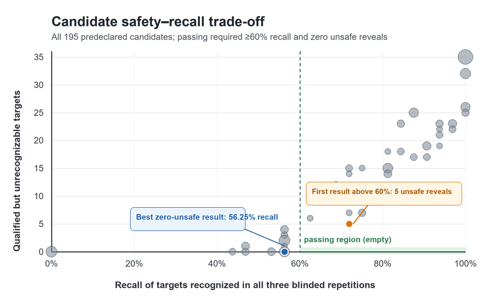
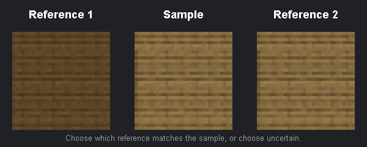
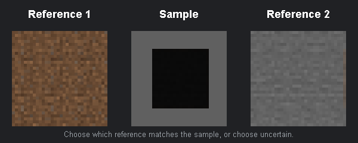
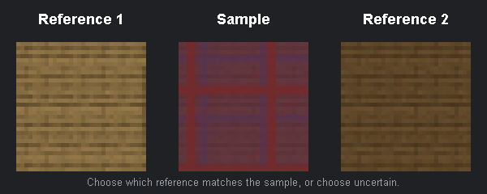
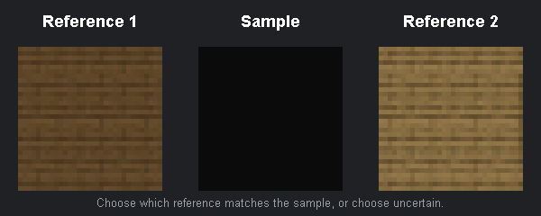

# Base-identity qualification calibration

**Verified outcome:** A valid single-observer development session found no member of the
predeclared simple rule family that both retained enough recognizable opaque/cutout targets and
avoided revealing exact identities that were not recognizable. The tested family therefore
failed development. No candidate was selected, the held-out partition remained sealed, and no
agent-facing visibility policy was approved.

| | |
| --- | --- |
| Status | Completed experimental development calibration; negative result |
| Target | Minecraft Java Edition 1.16.1 |
| Tested analysis implementation | `a45cabb` (`feat(visibility): add base identity qualification study`) |
| Manual labeling and analysis | September 17, 2026 |
| Input | `translucent-observation-probe-v6`, aligned `640 × 360` researcher evidence |
| Ordinary F8 format | `semantic-observation-v3`, unchanged |

## Question

Earlier renderer experiments produced an aligned coefficient describing how strongly supported
opaque or cutout base geometry could still influence Minecraft's composed image. That coefficient
kept lighting, fog, foreground translucency, supported camera overlays, and first-person
boundaries explicit. It deliberately did not claim that a texture was recognizable.

This calibration asked the next bounded question:

> Can a simple base-influence threshold plus spatial-support rule conservatively qualify exact
> block identity, or does that rule reveal identities that the rendered evidence does not safely
> distinguish?

The distinction matters because an exact semantic class can preserve a block's registry identity
even when ordinary RGB is very dark or obstructed. Releasing that class without qualification
could provide privileged vision. At the same time, seeing that some geometry exists is not the
same as recognizing its exact subtype. The experiment tested the latter.

## Evidence and blinded task

The input matrix contained 31 accepted version-6 F9 captures. It covered clear noon and midnight,
enclosed darkness, controlled block lighting at two brightness settings, Night Vision, one and
two stained-glass layers, stabilized underwater rendering, animated fire, a fully covering
inside-block overlay, an all-sky boundary, and End and Nether lighting. Two five-frame groups
checked fixed block-light and fire-animation behavior. All inputs used the same-frame pre-HUD RGB
field aligned with the existing researcher diagnostics.

Six block pairs were divided equally between development and held-out partitions before labeling.
The development pairs were stone versus dirt, white versus light-gray concrete, and oak versus
spruce planks. The complete plan contained 150 unique targets and 450 opaque presentations. Only
the 75 development targets and their 225 presentations were exposed.

Each presentation contained a 32-pixel RGB crop enlarged with fixed nearest-neighbor scaling,
plus clear-noon reference swatches for the pair. Reference side, trial order, batch order, and
horizontal mirroring were deterministic but hidden from the labeler. The available responses
were `left`, `right`, and `uncertain`. Every target appeared three times; it counted as exactly
recognizable only when all three answers were correct.

This is pairwise visual discrimination, not open-set block naming. The references reduce reliance
on memorized Minecraft textures, while the isolated crop removes world context. Those choices
make the task controlled but do not reproduce ordinary gameplay reasoning.

## Frozen candidate family

The evaluator tested 195 candidates: three fixed channel reductions, 13 byte thresholds, and five
minimum connected-component areas. Each candidate used only supported base-influence pixels,
applied an exact-zero override, eroded one pixel around class/depth/support boundaries, and formed
four-connected components without crossing an exact semantic class boundary.

A development candidate had to satisfy all of the following:

- zero qualified targets labeled unrecognizable;
- at least 60% recall among targets recognized in all three repetitions;
- no qualified exact-zero, unsupported, or background pixel;
- no target-level toggle in either fixed temporal group; and
- no more than 0.5% interior-pixel change across the block-light repeat group.

Using exact class equality to form components was permitted only inside this researcher analysis.
A successful calibration would still have required a separate information-policy decision before
that grouping could affect an agent observation. The candidate family, input hashes, controls,
and pass criteria were locked before responses were scored.

## Development results

The response file contained all 225 required answers and passed the strict parser. The clear-noon
catch trials were 18/18 correct. All 18 inside-block negative-control presentations were answered
`uncertain`, so none produced an identity selection; the predefined leakage test therefore
returned its neutral p-value of 1.0. The session validity controls passed.

Across the 75 development targets, 32 were recognizable in all three repetitions, 26 were stably
unrecognizable, and 17 had inconsistent outcomes. Exact recognition varied substantially by pair:

| Development pair | Recognizable | Stably unrecognizable | Inconsistent | Total |
| --- | ---: | ---: | ---: | ---: |
| Stone / dirt | 16 | 6 | 3 | 25 |
| White / light-gray concrete | 7 | 13 | 5 | 25 |
| Oak / spruce planks | 9 | 7 | 9 | 25 |

The controlled conditions also produced a coherent pattern without reducing recognition to a
single lighting value. Clear noon was 10/10 recognizable. Enclosed darkness was 0/6, Moody block
lighting was 1/6, Bright block lighting was 2/6, and Night Vision was 4/6. One and two glass-layer
conditions were each 3/6, underwater was 1/6, fire was 3/3, the inside-block set was 0/8, the End
was 2/3, and the Nether was 1/3.

No candidate passed. The strongest candidates with zero unsafe reveals retained 18 of 32
recognizable targets, or 56.25%, below the frozen 60% requirement. The candidate with the fewest
unsafe reveals while exceeding 60% retained 23 of 32 targets, or 71.875%, but qualified five
unrecognizable targets. Both representative points had zero forbidden pixels, zero temporal
toggles, and zero block-light repeat changes; their failure was the safety/recall trade-off itself.

*Bubble area reflects how many candidates shared a result. The green segment is the predeclared
passing region: at least 60% recall with zero unsafe reveals. It contains no candidate. The chart
summarizes researcher analysis; it is not a production threshold curve.*

The development freeze consequently records `simple_family_failed`. Because no development
candidate existed to validate, the held-out labeler was not released, the held-out key was not
opened, and no held-out analysis was performed.

## Representative trial evidence

The following images are actual 600 by 240 blinded presentations copied byte-for-byte from the
verified development session. They contain only the displayed RGB crop and reference swatches,
not semantic classes, coefficients, metadata, answers, or raw buffers.

*Clear noon, oak versus spruce planks. The center sample's exact identity was selected correctly
in all three randomized repetitions. This positive catch demonstrates that the interface could
support exact pair discrimination under a favorable condition.*

*Enclosed darkness, stone versus dirt. The center sample was answered `uncertain` in all three
repetitions. The result concerns exact identity: it does not prove that no block outline or coarse
material information was available.*

*Oak versus spruce through the two-layer stained-glass condition. All three answers were
incorrect even though the center crop retained color and structure. Foreground appearance can
therefore disrupt exact discrimination without simply making every pixel dark.*

*Inside-block negative control, oak versus spruce references. The underlying semantic target
still existed, but the ordinary center crop carried no usable pair evidence; all three responses
were `uncertain`. Reference order and filenames did not leak the answer.*

## Interpretation

The experiment establishes a negative result for one deliberately simple exact-identity rule
family. It does not establish that the observer received no useful information whenever exact
identity failed. A wooden-plank appearance may remain recognizable as wood without distinguishing
oak from spruce; a dark outline may reveal occupied geometry without revealing its material.
Those cases were correctly counted as unsafe for exact identity, but this study cannot score a
future coarse-category or geometry-only observation.

Context is similarly unresolved. Real play supplies neighboring blocks, biome cues, temporal
views, prior observations, and mechanics knowledge. The isolated crop removes those cues. The two
clear references, conversely, can make matching easier than unaided identification. The result is
therefore evidence about a controlled pairwise boundary, not general human vision, ordinary
Minecraft play, or strategic usefulness. No block pair was weighted according to speedrunning
value.

The predeclared RGB contrast diagnostic also did not provide a clean explanation. Recognizable
and unrecognizable targets overlapped substantially: some low-boundary-contrast targets were
recognized, while some high-contrast targets were not. The evidence does not justify silently
adding a contrast threshold, retuning the failed family, or fitting pair-specific exceptions.

## Automated verification and research boundaries

The complete clean workflow passed 157 tests across 37 suites, followed by build and production
remapping. The six focused calibration test classes cover the fixed 31-capture manifest, 150-target
and 450-presentation schedule, randomized opaque identifiers, strict version-6 capture reading,
RGB/PNG equality, crop generation, response completeness, exact three-repeat labels, candidate
arithmetic, boundary erosion, exact-zero handling, controls, temporal checks, input hashing, and
fail-closed held-out release.

The implemented analyzer then consumed the actual completed development file and wrote the
hash-locked negative freeze successfully. No source or runtime change was made after the clean
workflow. Ordinary F8 remained `semantic-observation-v3` throughout. Same-frame RGB, base-influence
values, response labels, candidate results, and exact diagnostic values remain researcher-only
and are never serialized into the agent observation.

No visibility threshold, RGB channel reduction, component size, class-suppression behavior,
`visible`/`unknown` result, coarse block taxonomy, or agent-facing policy was selected.

## Limitations

This was one internal labeler, not a population study. The monitor model was recorded as a
24.5-inch KOORUI G2511E, but final on-screen-display, Windows scaling, and GPU color-state values
were not preserved with the response file. The experiment supports an engineering decision, not
a calibrated psychophysics claim.

The matrix used vanilla resources, fixed 1920 by 1080 source capture reduced to 640 by 360,
selected opaque/cutout block-model textures, and controlled Fast/Fancy-compatible renderer paths.
It does not cover arbitrary resource packs, shaders, Fabulous graphics, animated or emissive
textures, fluids as base targets, entities, block entities, HUD, menus, or general overlays.

The held-out partition remains deliberately unevaluated. Adding graded responses such as
“geometry visible,” “material family visible,” and “exact subtype visible” would be a new
experiment requiring an approved category system; it cannot be recovered from the existing
left/right/uncertain answers. The negative result should not be weakened by relabeling or changing
the pass criterion after observing development performance.

## Reproduction

The `runBaseQualificationCalibration` Gradle task supports `generate`, `freeze-development`, and
`evaluate-held-out` modes. Reproduction requires a matching private study manifest and complete
version-6 F9 capture set. Generation writes separate blinded labelers and seals the held-out
partition. `freeze-development` accepts only a complete response TSV, verifies locked hashes,
evaluates the frozen candidate family, and releases the held-out labeler only when a valid session
produces a passing candidate. A failed family leaves it sealed. Raw captures, response data, and
answer keys are intentionally not committed.

## Implementation map

| Responsibility | Relevant files |
| --- | --- |
| Same-frame RGB encoding and GPU readback | [`SameFrameRgbEncoding.java`](../../src/main/java/io/github/minecraftaidiscovery/semantic/visibility/SameFrameRgbEncoding.java), [`SameFrameRgbGpuCapture.java`](../../src/main/java/io/github/minecraftaidiscovery/semantic/visibility/SameFrameRgbGpuCapture.java), [`GameRendererMixin.java`](../../src/main/java/io/github/minecraftaidiscovery/semantic/mixin/GameRendererMixin.java) |
| Strict version-6 capture validation and reconstruction | [`BaseQualificationCaptureReader.java`](../../src/main/java/io/github/minecraftaidiscovery/semantic/visibility/BaseQualificationCaptureReader.java), [`BaseQualificationCapture.java`](../../src/main/java/io/github/minecraftaidiscovery/semantic/visibility/BaseQualificationCapture.java) |
| Frozen matrix, geometry recovery, targets, and presentation schedule | [`BaseQualificationStudyManifest.java`](../../src/main/java/io/github/minecraftaidiscovery/semantic/visibility/BaseQualificationStudyManifest.java), [`BaseQualificationTargetGeometry.java`](../../src/main/java/io/github/minecraftaidiscovery/semantic/visibility/BaseQualificationTargetGeometry.java), [`BaseQualificationTrialPlan.java`](../../src/main/java/io/github/minecraftaidiscovery/semantic/visibility/BaseQualificationTrialPlan.java) |
| Blinded RGB presentation generation and held-out sealing | [`BaseQualificationTrialWriter.java`](../../src/main/java/io/github/minecraftaidiscovery/semantic/visibility/BaseQualificationTrialWriter.java), [`BaseQualificationPresentation.java`](../../src/main/java/io/github/minecraftaidiscovery/semantic/visibility/BaseQualificationPresentation.java) |
| Response validation, candidate family, and evaluation | [`BaseQualificationResponseSet.java`](../../src/main/java/io/github/minecraftaidiscovery/semantic/visibility/BaseQualificationResponseSet.java), [`BaseQualificationCandidate.java`](../../src/main/java/io/github/minecraftaidiscovery/semantic/visibility/BaseQualificationCandidate.java), [`BaseQualificationCandidateEvaluator.java`](../../src/main/java/io/github/minecraftaidiscovery/semantic/visibility/BaseQualificationCandidateEvaluator.java) |
| Hash-locked analysis, freeze, and command entry point | [`BaseQualificationAnalysisFiles.java`](../../src/main/java/io/github/minecraftaidiscovery/semantic/visibility/BaseQualificationAnalysisFiles.java), [`BaseQualificationCalibrationStudy.java`](../../src/main/java/io/github/minecraftaidiscovery/semantic/visibility/BaseQualificationCalibrationStudy.java), [`build.gradle`](../../build.gradle) |
| Focused schedule, labeler, response, evaluator, and sealing tests | [`BaseQualificationTrialPlanTest.java`](../../src/test/java/io/github/minecraftaidiscovery/semantic/visibility/BaseQualificationTrialPlanTest.java), [`BaseQualificationTrialWriterTest.java`](../../src/test/java/io/github/minecraftaidiscovery/semantic/visibility/BaseQualificationTrialWriterTest.java), [`BaseQualificationResponseSetTest.java`](../../src/test/java/io/github/minecraftaidiscovery/semantic/visibility/BaseQualificationResponseSetTest.java), [`BaseQualificationCandidateEvaluatorTest.java`](../../src/test/java/io/github/minecraftaidiscovery/semantic/visibility/BaseQualificationCandidateEvaluatorTest.java), [`BaseQualificationAnalysisFilesTest.java`](../../src/test/java/io/github/minecraftaidiscovery/semantic/visibility/BaseQualificationAnalysisFilesTest.java) |
