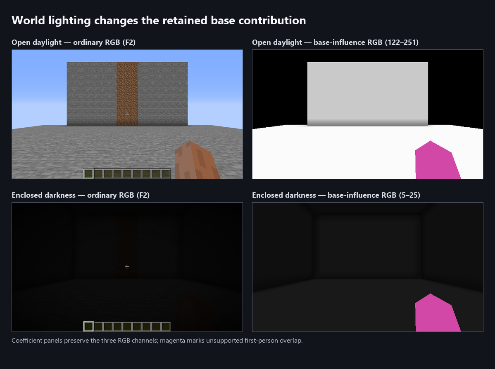
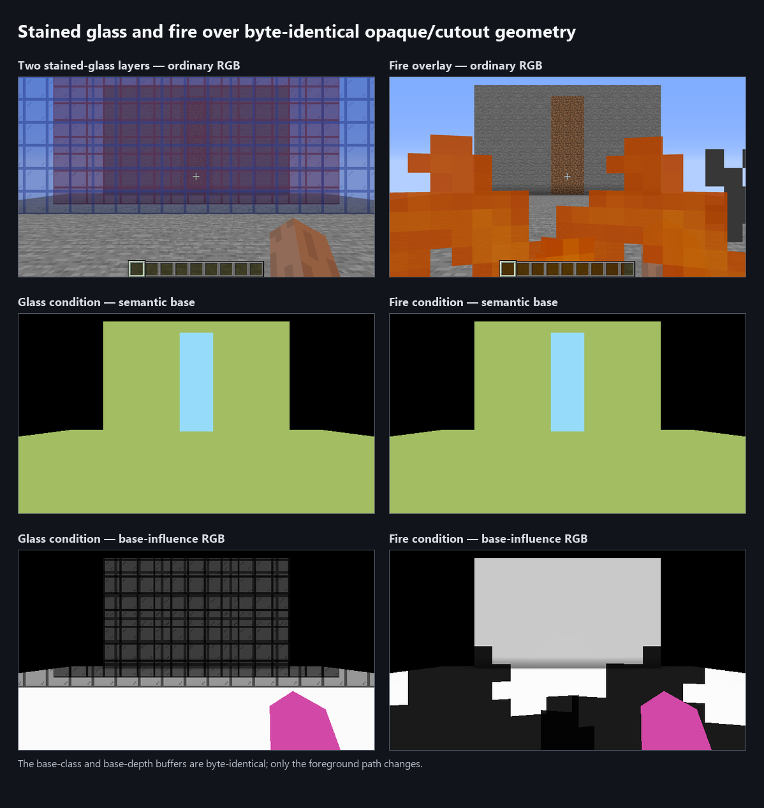
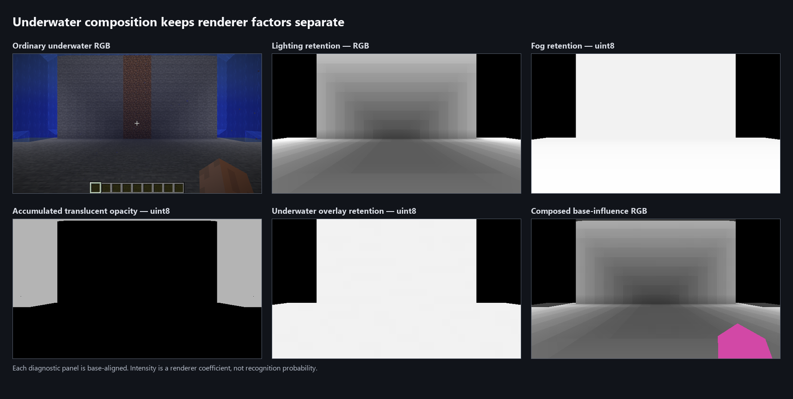
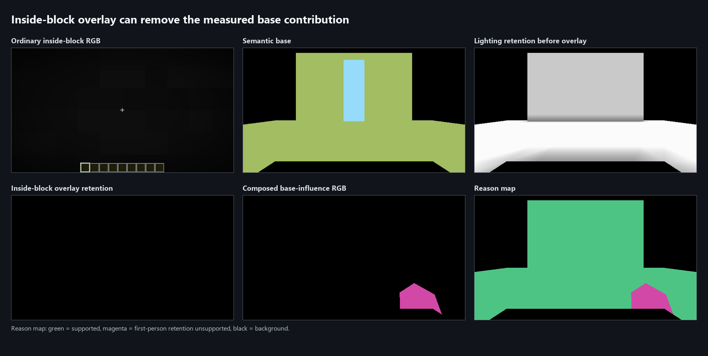
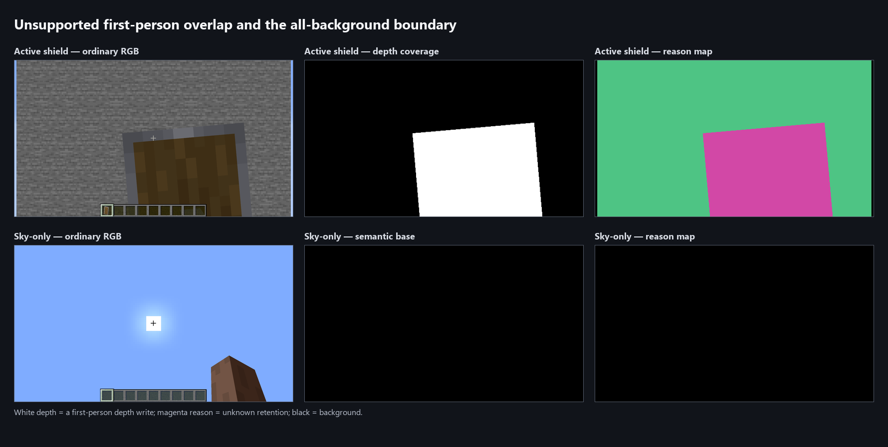

# Offline base-influence composition study

**Verified outcome:** The separate researcher-only measurements of Minecraft Java Edition
1.16.1 lighting, fog, foreground translucency, and camera overlays can be combined offline into
an aligned per-channel coefficient describing how strongly a supported opaque/cutout base signal
can still influence the composed image. Unsupported pixels remain explicit rather than being
misreported as darkness. This is a renderer diagnostic, not perceptual visibility or an
agent-facing observation policy.

| | |
| --- | --- |
| Status | Experimental offline researcher study, verified within the scope below |
| Target | Minecraft Java Edition 1.16.1 |
| Tested study implementation | `65ee4e7` (`feat(visibility): analyze version 5 probe captures`) |
| Manual verification | September 13, 2026 |
| Input format | `translucent-observation-probe-v5`, fixed `640 × 360` |
| Ordinary F8 format | `semantic-observation-v3`, unchanged |

## Question

Earlier experiments isolated several reasons why an exact opaque or cutout semantic identity may
be present even when its ordinary rendered appearance is reduced or covered: world lighting,
fog, translucent surfaces, the underwater/fire/inside-block camera overlays, and first-person
hands or held items. Each measurement was useful independently, but none described how the
measured stages act together.

This study asked whether the already captured F9 buffers form a coherent, auditable composition
without adding another render pass, querying world or player state again, changing normal RGB,
or choosing a visibility threshold. The goal was to measure retained **base influence**, while
preserving every known unsupported boundary.

## Base influence and the multiplication boundary

For one positive opaque/cutout base pixel and RGB channel `c`, the supported calculation is:

```text
round(L[c] × F × (255 − A) × O / 255³)
```

All inputs and the result are unsigned bytes:

- `L[c]` is the renderer-derived lighting response for the channel, including the active
  lightmap and the block renderer's ambient-occlusion/directional multiplier;
- `F` is base fog retention;
- `A` is accumulated translucent opacity, so `255 − A` is foreground transmission;
- `O` is destination-RGB retention from the supported camera-overlay path.

The implementation uses one 64-bit integer product and rounds once at the final byte boundary.
This avoids order-dependent error from repeatedly rounding intermediate byte products. The
calculation is offline: it reads existing version-5 artifacts and neither adds a new F9 field nor
writes a composed buffer into the runtime capture.

The coefficient describes the surviving linear contribution of the measured base signal through
these multiplicative renderer stages. It deliberately excludes base texture color, biome tint,
fog color, overlay source color, and later rendering. It is therefore not the final RGB pixel.
It is also not a probability that a human or model can recognize a block. Recognition still
depends on texture contrast, spatial extent, neighboring pixels, adaptation, and the content
added by foreground effects.

## Explicit status and unsupported reasons

The result stores a separate byte beside the three coefficient channels:

| Value or bit | Meaning |
| ---: | --- |
| `0` | Semantic base is background; there is no base influence to measure |
| `1` | All required factors are supported and the RGB coefficient is valid |
| `2` | The base-lighting source is unsupported |
| `4` | Translucent storage overflow makes foreground transmission incomplete |
| `8` | First-person depth coverage exists, but its RGB retention is unknown |

Unsupported bits can be combined. Their RGB output remains zero, but the reason byte prevents
that zero from being interpreted as a measured dark result. Background is also validated against
the base-masked lighting, fog, overlay, and first-person fields; inconsistent data rejects the
capture instead of producing a result.

First-person depth deserves the explicit unsupported state. The depth probe established that a
translucent held-glass item can write depth while still blending the world behind it. Treating any
depth write as zero transmission would silently model every hand and item as opaque. The current
evidence supports only “retention unknown here,” not a replacement coefficient.

## Strict version-5 reader

The offline reader accepts only complete `translucent-observation-probe-v5` directories. It
requires the pinned Minecraft and Yarn versions, `640 × 360` top-left row-major layout, Fast or
Fancy graphics, vanilla resources, researcher-only/non-agent-visible status, no applied
threshold, the unchanged F8 v3 declaration, and the four-slot translucent storage marked as
non-production.

Every required artifact must use its exact declared name, bytes-per-pixel value, byte length, and
on-disk length. Base classes are decoded as unsigned little-endian 16-bit values. Missing,
truncated, malformed, linked, or incompatible inputs fail rather than receiving a neutral
substitute. A mixed-root scan skips older formats; directly reading an older format is rejected.
The analysis command emits aggregate counts and per-channel minimum, maximum, and mean values
only. Raw diagnostic values remain researcher-only.

## Controlled cross-condition matrix

The version-5 matrix used vanilla resources, Fancy graphics, no post shader, paired F2
screenshots, and F9 diagnostic output. It covered open daylight, enclosed darkness, two stained-
glass layers, stabilized underwater terrain, fire, a fully obstructing inside-block view, and an
all-sky boundary. A second daylight frame was retained as an independent replacement control
after the arena was rebuilt.

All eight directories contained the expected 20 artifacts and passed the strict reader. Every
capture had zero unsupported-lighting pixels and zero translucent overflow. The table reports
the three channels together because R, G, and B were equal in these particular controlled
captures; the implementation still preserves them independently and selects no channel
reduction.

| Condition | Background | Supported | First-person unsupported | Supported RGB coefficient |
| --- | ---: | ---: | ---: | --- |
| Open daylight | 76,844 | 143,417 | 10,139 | `122–251`; mean `228.168` per channel |
| Enclosed darkness | 0 | 220,261 | 10,139 | `5–25`; mean `18.886` per channel |
| Two stained-glass layers | 70,164 | 150,097 | 10,139 | `4–251`; mean `136.931` per channel |
| Stabilized underwater | 49,910 | 171,169 | 9,321 | `50–217`; mean `114.885` per channel |
| Fire overlay | 70,164 | 150,097 | 10,139 | `3–252`; mean `130.003` per channel |
| Inside-block overlay | 86,816 | 137,245 | 6,339 | `0` throughout |
| Sky-only boundary | 230,400 | 0 | 0 | no supported value |
| Replacement daylight | 55,932 | 164,329 | 10,139 | `123–251`; mean `223.513` per channel |

The original and replacement daylight frames are valid independent daylight distributions, but
neither is a byte-identical companion to the later glass/fire pair because arena and effective
camera state changed during setup. They must not be treated as a pixelwise matched third
condition.

## Visual evidence

The coefficient panels below show the three calculated RGB channels directly, without reducing
them to one scalar. Magenta is a presentation color for first-person retention being unsupported;
it is not a coefficient. Black can mean background or a supported coefficient of zero, so the
semantic-base and reason panels provide the necessary distinction. Ordinary F2 screenshots were
taken immediately before F9 and resized for presentation; the diagnostic panels within each F9
capture are exactly aligned.



*Daylight retains a strong base contribution, while the same renderer-derived concept becomes
small in enclosed darkness. The comparison measures the lighting path; it does not claim that a
particular value is recognizable.*



*The stained-glass and fire captures have byte-identical base-class and base-depth buffers. This
is the strongest fixed-geometry evidence: the base stays fixed while accumulated glass opacity
or spatial fire-overlay retention changes the composed coefficient. It does not rank the two
conditions perceptually.*

The stained-glass capture contained 158,080 nonzero accumulated-opacity pixels with values
`102–246`. The fire capture had no accumulated translucent opacity and instead recorded overlay
retention from `3–255`. Their equal background, supported, and first-person-unsupported counts
confirm that the reason partition stayed fixed while the measured foreground path changed.



*Underwater terrain exercises several measured stages together. Fog retention was `240–254`,
underwater-overlay retention was `241–242`, and 53,454 pixels carried accumulated water opacity
of `180`. The composed result preserves their separation from lighting and from ordinary RGB.*



*The semantic base and pre-overlay lighting remain present, but the verified inside-block overlay
has zero destination-RGB retention across the base. Supported pixels consequently have a measured
coefficient of zero; magenta pixels remain unsupported because of first-person depth rather than
being folded into that measurement.*



*Active shield use marks 57,353 positive-base pixels as first-person retention unsupported. The
sky control contains no positive base pixel, so every reason remains background and no coefficient
is invented even though the ordinary view still shows the player's arm.*

Each figure was assembled from the verified screenshots, raw buffers, and diagnostic PNGs. The
generation check reconstructed the integer product, matched the study's counts, ranges, and
means, decoded selected diagnostic PNGs pixel-for-pixel against their raw fields, confirmed the
glass/fire base-class and depth files were byte-identical, and rechecked every embedded panel
after saving. All five finished figures were then inspected visually.

## Automated verification

All 113 tests across 27 suites passed with no failures, errors, or skips. The new focused tests
cover multiplication endpoints and one-round quantization, combined reason bits, background
masking, immutable outputs, input lengths and value domains, little-endian class decoding,
version filtering, researcher-only metadata boundaries, exact declared and actual artifact
lengths, truncated inputs, and aggregate summary accounting.

The same study code successfully read all 20 available version-5 captures: the earlier 12-case
first-person matrix and the eight cross-condition captures above. The manual sequence produced
no capture failure, flash, corruption, stale image, crash, or probe-specific error. This offline
feature does not alter Minecraft rendering, F9 capture behavior, or ordinary F8 output.

## Limitations and unresolved policy

The supported product covers positive opaque/cutout base pixels in the verified vanilla Fast or
Fancy paths. Fluid-rendered base lighting remains unsupported. Four stored translucent
candidates are an experimental diagnostic capacity; any reported fifth-layer overflow
invalidates the affected base pixel rather than pretending the foreground is complete. The
camera-overlay factor covers only the verified underwater, fire, and inside-block paths, and
first-person depth has no retention coefficient.

Entities, block entities, particles, weather, clouds, third-person character geometry, HUD,
menus, vignette, portal and pumpkin effects, world-border effects, and post-processing are not
represented. Fabulous graphics, replacement resources, shader packs, and replacement renderers
remain outside the accepted reader state. Continuous-capture performance was not studied.

Most importantly, base influence is not perceptual visibility. Texture and tint are excluded
from the coefficient, while additive fog and overlay colors can still carry or remove visual
structure in ways a multiplicative coefficient does not describe. No RGB-channel reduction,
threshold, spatial rule, semantic-suppression behavior, `visible`/`unknown` class, or agent-facing
policy was selected. The exact inputs and composed values remain researcher-only, and ordinary
F8 remains `semantic-observation-v3`.

## Reproduction

Generate complete F9 version-5 captures using the conditions and supported runtime boundaries
documented by the individual translucent, lighting, camera-overlay, and first-person reports.
After compiling the project, invoke `BaseInfluenceProbeStudy` with a directory whose direct
children are capture directories. The strict reader will analyze compatible version-5 children,
reject incomplete or inconsistent inputs, and print aggregate tab-separated summaries without
writing composed capture artifacts.

## Implementation map

| Responsibility | Relevant files |
| --- | --- |
| Deterministic per-channel product and validation | [`BaseInfluenceComposition.java`](../../src/main/java/io/github/minecraftaidiscovery/semantic/visibility/BaseInfluenceComposition.java), [`BaseInfluenceCompositionResult.java`](../../src/main/java/io/github/minecraftaidiscovery/semantic/visibility/BaseInfluenceCompositionResult.java) |
| Background, supported, and combinable unsupported reasons | [`BaseInfluenceReasonEncoding.java`](../../src/main/java/io/github/minecraftaidiscovery/semantic/visibility/BaseInfluenceReasonEncoding.java) |
| Strict version-5 metadata and artifact reader | [`BaseInfluenceProbeDirectoryReader.java`](../../src/main/java/io/github/minecraftaidiscovery/semantic/visibility/BaseInfluenceProbeDirectoryReader.java), [`BaseInfluenceProbeCapture.java`](../../src/main/java/io/github/minecraftaidiscovery/semantic/visibility/BaseInfluenceProbeCapture.java) |
| Aggregate summary and command-line study | [`BaseInfluenceProbeSummary.java`](../../src/main/java/io/github/minecraftaidiscovery/semantic/visibility/BaseInfluenceProbeSummary.java), [`BaseInfluenceProbeStudy.java`](../../src/main/java/io/github/minecraftaidiscovery/semantic/visibility/BaseInfluenceProbeStudy.java) |
| Version-5 input serialization and metadata | [`TranslucentProbeCapture.java`](../../src/main/java/io/github/minecraftaidiscovery/semantic/translucent/TranslucentProbeCapture.java), [`TranslucentProbeMetadata.java`](../../src/main/java/io/github/minecraftaidiscovery/semantic/translucent/TranslucentProbeMetadata.java) |
| Composition, reader, rejection, and summary tests | [`BaseInfluenceCompositionTest.java`](../../src/test/java/io/github/minecraftaidiscovery/semantic/visibility/BaseInfluenceCompositionTest.java), [`BaseInfluenceProbeDirectoryReaderTest.java`](../../src/test/java/io/github/minecraftaidiscovery/semantic/visibility/BaseInfluenceProbeDirectoryReaderTest.java) |
