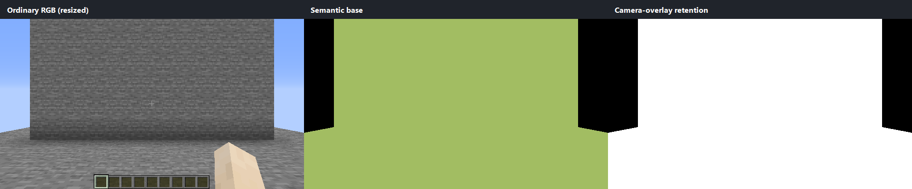
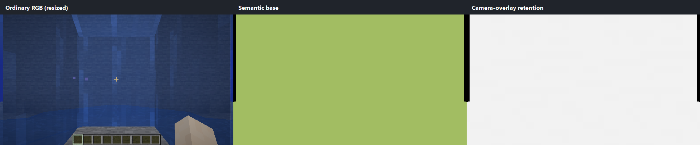
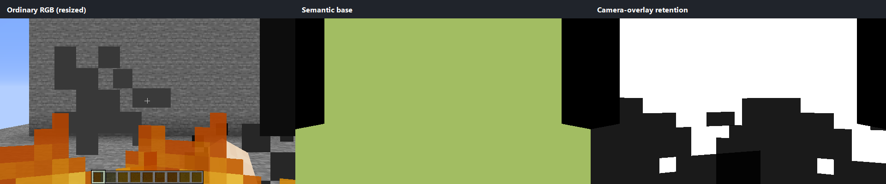
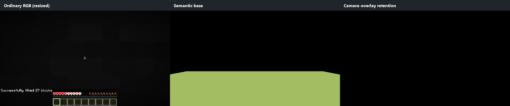
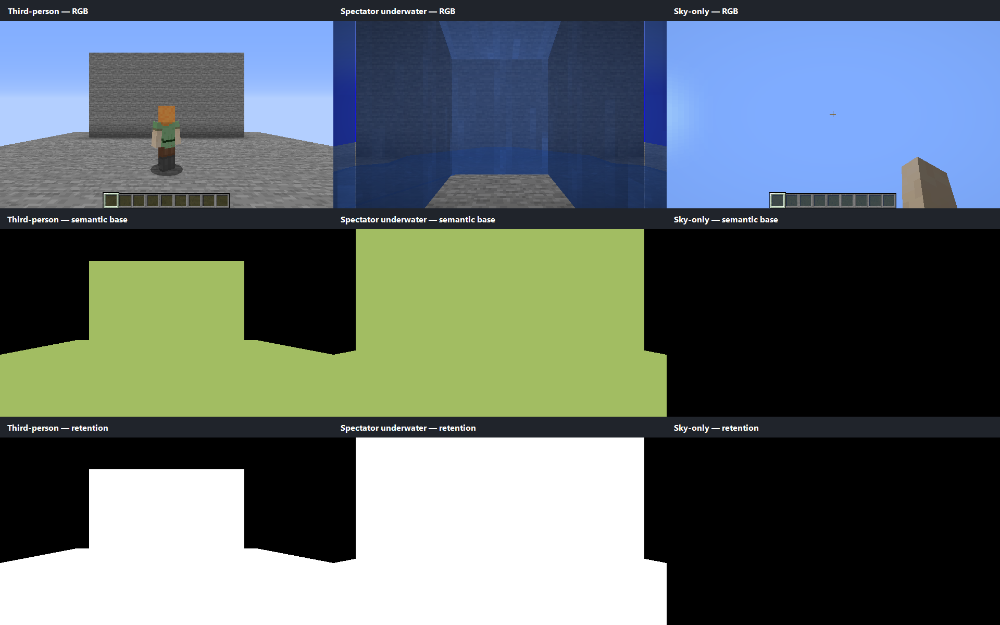

# Camera-overlay retention diagnostic probe

**Verified outcome:** Minecraft Java Edition 1.16.1's original inside-block, underwater,
and fire camera-overlay draws can be mirrored into an aligned, researcher-only measurement
of how much pre-overlay RGB they retain. The diagnostic does not rerun overlay selection,
change normal rendering, or alter the ordinary semantic observation contract.

| | |
| --- | --- |
| Status | Experimental researcher diagnostic, verified within the scope below |
| Target | Minecraft Java Edition 1.16.1 |
| Tested implementation | `525d075f9f5ff4463eb063d4753279673eee7003` (`feat(overlay): capture camera overlay retention`) |
| Manual verification | September 12, 2026 |
| Probe format | `translucent-observation-probe-v4`, fixed `640 × 360` |
| Ordinary F8 format | `semantic-observation-v3`, unchanged |

## Question

The semantic base can preserve an exact opaque or cutout block identity even when a later
full-screen effect obscures Minecraft's ordinary view. Exposing that identity without accounting
for the obstruction could give an agent privileged vision. Earlier experiments measured
translucent contributions, fog retention, and lighting separately, but not the camera overlays
drawn after first-person hands and held items.

This experiment asked whether three specific vanilla camera overlays—being inside a block,
underwater, and on fire—could be measured from Minecraft's actual rendered data. The goal was
evidence about this boundary, not a visibility score, semantic suppression rule, or agent-facing
field.

## Renderer path and diagnostic quantity

Minecraft renders terrain and other world contributions before the first-person hand and held
item. It then invokes `InGameOverlayRenderer` in the first-person hand pass. Vanilla selects an
inside-block texture, checks whether the camera is underwater, and checks whether the player is
on fire. The inside-block path emits one unblended full-screen quad; underwater emits one
source-alpha-blended quad; fire emits two overlapping source-alpha-blended quads. Later HUD,
screen, and post-processing effects remain outside this sequence.

The probe observes only the vertex packet already emitted for those three methods. It does not
invoke the overlay renderer again or repeat vanilla's inside-block search. It does not serialize
the selected block, sprite or texture identity, raw UVs, nearby blocks, or player flags.

For an F9 request, the diagnostic creates a white `640 × 360` target and copies the main
framebuffer depth after the hand/item pass. It mirrors each original overlay quad to that target
while forcing source RGB to zero:

- the unblended inside-block quad writes zero wherever it passes;
- underwater and fire preserve the original source alpha and write
  `destination × (1 - source alpha)`;
- successive draws compose on the same target, including the two fire quads.

The resulting `base.camera-overlay-retention.u8` contains one unsigned byte per pixel: `255`
means the overlay left the earlier RGB unchanged, and `0` means it replaced all earlier RGB at
that fragment. Values between them measure partial destination retention. This is a local
rendering coefficient—not the overlay's added color, the final RGB brightness, or the
probability that a block can be recognized.

## Same-frame alignment and research boundary

F9 first prepares the existing semantic base, lighting, fog, fluid, and translucent arrays at
the terrain hook. Those arrays remain in memory until the same frame reaches the camera-overlay
stage. Serialization occurs only after that stage ends. The camera-overlay field therefore uses
the same `640 × 360` coordinate system as the base rather than a later frame or independent
capture.

The saved field is valid only where `base.classes.u16le` contains a positive solid, cutout-mipped,
or cutout class. Background is stored as zero. The semantic base must therefore accompany the
grayscale image: black can mean zero retention on a valid base pixel or simply no valid base
pixel. The probe is disabled by default, remains researcher-only, and is never included in F8.

## Controlled verification

The manual matrix used Fancy graphics, bundled vanilla resources, no post shader, and paired F2
screenshots. The stone wall and camera were fixed where the condition allowed it. Seven retained
captures covered the three supported overlays plus perspective, spectator, and background
boundaries.

| Condition | Renderer record | Positive base pixels | Observed retention |
| --- | --- | ---: | --- |
| First-person baseline | Stage entered; no overlay draw | 200,790 | Every valid pixel `255` |
| First-person underwater | One `underwater` draw | 226,554 | Every valid pixel `241` or `242` |
| First-person fire | Two `fire` draws | 200,790 | 84,937 pixels attenuated; 115,853 remained `255`; range `3–255` |
| First-person inside block | One `inside_block` draw | 83,086 | Every valid pixel `0` |
| Third-person baseline | Overlay stage not entered | 135,264 | Every valid pixel `255` |
| Spectator underwater | Stage entered; no supported draw | 210,026 | Every valid pixel `255` |
| Sky-only boundary | Stage entered; no supported draw | 0 | Entire saved field `0` |

Every capture directory contained all 18 version-4 files. The raw overlay field was exactly
230,400 bytes, every declared artifact length matched its file, and every visualization was
`640 × 360`. No background pixel contained a nonzero saved value. The sky-only control directly
verified the all-background result without an active overlay; automated masking tests separately
verify that arbitrary retention values cannot populate background pixels.

The ordinary baseline F8 metadata remained `semantic-observation-v3`. Log inspection found no
capture failure, exception, GL error, or framebuffer error. No flash, stale framebuffer, color
corruption, crash, or other rendering disturbance was observed during captures or subsequent
movement. The inside-block test caused ordinary suffocation after its capture had completed;
that gameplay effect was expected from the temporary test enclosure and was not a probe failure.

## Visual evidence

Each comparison places resized ordinary RGB on the left, the aligned false-color semantic base
in the center, and camera-overlay retention on the right. White retention is `255`; darker values
mean less prior RGB was retained. Diagnostic intensity is not a recognition probability and does
not authorize exact semantic identity.

*The first-person baseline has no camera overlay. Positive base geometry remains white in the
retention panel, while black follows background regions in the semantic base.*

*The underwater overlay coherently reduces retention across every positive base pixel. The
ordinary RGB also contains water, fog, texture, and lighting effects that this field does not
attempt to combine.*

*Two renderer-emitted fire quads create a spatial attenuation pattern. White areas retain prior
RGB; dark areas retain less. Neither result says whether the underlying stone is recognizable.*

*The close stone overlay obscures the ordinary view. The diagnostic records zero retention on
all positive base pixels, while the separate semantic base shows where those valid pixels exist.
No selected inside-block identity is stored.*

*Third-person skips the camera-overlay stage, and spectator underwater enters the first-person
stage without drawing the supported underwater overlay; both retain `255` on their positive base.
The sky-only column has no positive semantic base, so its saved retention field is entirely zero.*

## Automated verification

All 85 tests across 23 suites passed with no failures, errors, skips, or omissions. Focused tests
cover exact dimensions, unsigned-byte bounds, positive-base masking, deterministic repeated
source-alpha composition, no-overlay defaults, draw ordering and exact counts, invalid
lifecycles, result validation, restoration on success and failure, version-4 metadata, preserved
translucent fields, default-disabled configuration, and the unchanged F8 schema.

The clean test, build, and production-remapping workflow passed. The remapped JAR contained the
new overlay classes and mixins, and the Java 8 development client reached the Minecraft 1.16.1
title screen with the diagnostic enabled before in-world testing.

## Limitations and unresolved policy

This result covers only the verified vanilla inside-block, underwater, and fire paths. It
requires Fast or Fancy graphics, bundled resources, no active post shader, the expected fixed
function state and draw counts, and GL 3.0 depth transfer. Fabulous graphics, replacement
resources, shaders, unexpected overlay geometry, and nonstandard render state fail rather than
silently producing an approximation.

The measurement excludes overlay source color, texture recognizability, first-person hands and
held-item identity, entities, particles, weather, portal and pumpkin effects, vignette, HUD,
menus, and later post-processing. The copied hand depth preserves the tested overlays' normal
depth interaction; it does not turn hand geometry into a semantic occlusion result. Fluid
geometry is also outside the positive base coverage used by this field.

No visibility threshold has been selected. The experiment does not establish that camera-overlay
retention alone determines recognizability, approve the exact values for agent access, or decide
how overlays should combine with lighting, fog, texture contrast, and translucent surfaces.
Ordinary F8 remains the only agent-facing semantic capture in this prototype.

## Reproduction

Launch the pinned client with `./gradlew runClient -PtranslucentProbe=true` (or the Windows
wrapper equivalent), use vanilla resources with Fast or Fancy graphics and no post shader, then
press F9 in-world. A successful capture writes `translucent-observation-probe-v4`; F8 separately
writes `semantic-observation-v3`.

Reproduction should pair F2 and F9 for no-overlay, underwater, fire, and inside-block conditions,
then exercise third-person, spectator-underwater, and sky-only boundaries. An inside-block test
must keep every sampled camera point inside suffocating geometry; Minecraft otherwise pushes the
player out before capture. Remove temporary containment immediately after saving.

## Implementation map

| Responsibility | Relevant files |
| --- | --- |
| Opt-in configuration and F9 request | [`build.gradle`](../../build.gradle), [`TranslucentProbeConfiguration.java`](../../src/main/java/io/github/minecraftaidiscovery/semantic/translucent/TranslucentProbeConfiguration.java), [`TranslucentProbeCaptureRequests.java`](../../src/main/java/io/github/minecraftaidiscovery/semantic/translucent/TranslucentProbeCaptureRequests.java), [`KeyboardMixin.java`](../../src/main/java/io/github/minecraftaidiscovery/semantic/mixin/KeyboardMixin.java) |
| Same-frame preparation and completion | [`WorldRendererMixin.java`](../../src/main/java/io/github/minecraftaidiscovery/semantic/mixin/WorldRendererMixin.java), [`GameRendererMixin.java`](../../src/main/java/io/github/minecraftaidiscovery/semantic/mixin/GameRendererMixin.java), [`CameraOverlayRetentionCapture.java`](../../src/main/java/io/github/minecraftaidiscovery/semantic/overlay/CameraOverlayRetentionCapture.java) |
| Overlay-path classification and draw tracking | [`InGameOverlayRendererMixin.java`](../../src/main/java/io/github/minecraftaidiscovery/semantic/mixin/InGameOverlayRendererMixin.java), [`CameraOverlayKind.java`](../../src/main/java/io/github/minecraftaidiscovery/semantic/overlay/CameraOverlayKind.java), [`CameraOverlayRetentionTracker.java`](../../src/main/java/io/github/minecraftaidiscovery/semantic/overlay/CameraOverlayRetentionTracker.java) |
| Original packet interception, GPU mirroring, and state restoration | [`BufferRendererMixin.java`](../../src/main/java/io/github/minecraftaidiscovery/semantic/mixin/BufferRendererMixin.java), [`CameraOverlayRetentionGpuTransport.java`](../../src/main/java/io/github/minecraftaidiscovery/semantic/overlay/CameraOverlayRetentionGpuTransport.java) |
| Buffer validation, masking, metadata, serialization, and visualization | [`CameraOverlayRetentionBufferEncoding.java`](../../src/main/java/io/github/minecraftaidiscovery/semantic/overlay/CameraOverlayRetentionBufferEncoding.java), [`CameraOverlayRetentionResult.java`](../../src/main/java/io/github/minecraftaidiscovery/semantic/overlay/CameraOverlayRetentionResult.java), [`TranslucentProbeCapture.java`](../../src/main/java/io/github/minecraftaidiscovery/semantic/translucent/TranslucentProbeCapture.java), [`TranslucentProbeMetadata.java`](../../src/main/java/io/github/minecraftaidiscovery/semantic/translucent/TranslucentProbeMetadata.java) |
| Focused behavior and metadata tests | [`CameraOverlayRetentionBufferEncodingTest.java`](../../src/test/java/io/github/minecraftaidiscovery/semantic/overlay/CameraOverlayRetentionBufferEncodingTest.java), [`CameraOverlayRetentionGpuTransportTest.java`](../../src/test/java/io/github/minecraftaidiscovery/semantic/overlay/CameraOverlayRetentionGpuTransportTest.java), [`CameraOverlayRetentionResultTest.java`](../../src/test/java/io/github/minecraftaidiscovery/semantic/overlay/CameraOverlayRetentionResultTest.java), [`CameraOverlayRetentionTrackerTest.java`](../../src/test/java/io/github/minecraftaidiscovery/semantic/overlay/CameraOverlayRetentionTrackerTest.java), [`TranslucentProbeMetadataTest.java`](../../src/test/java/io/github/minecraftaidiscovery/semantic/translucent/TranslucentProbeMetadataTest.java), [`SemanticCaptureMetadataTest.java`](../../src/test/java/io/github/minecraftaidiscovery/semantic/SemanticCaptureMetadataTest.java) |
