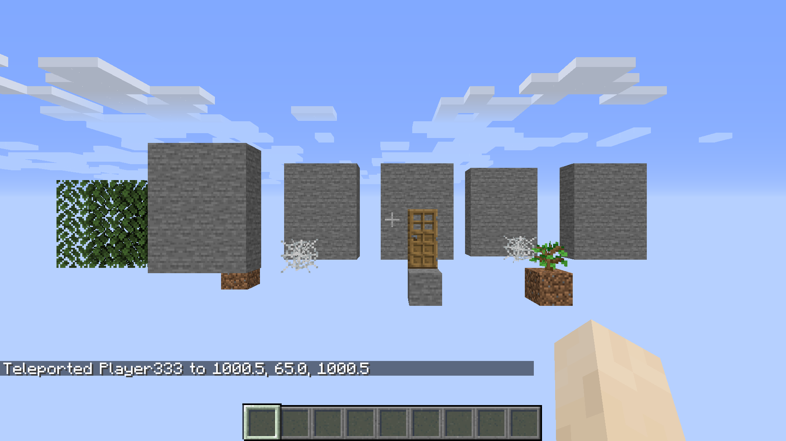
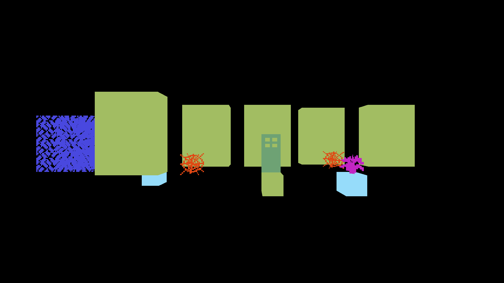
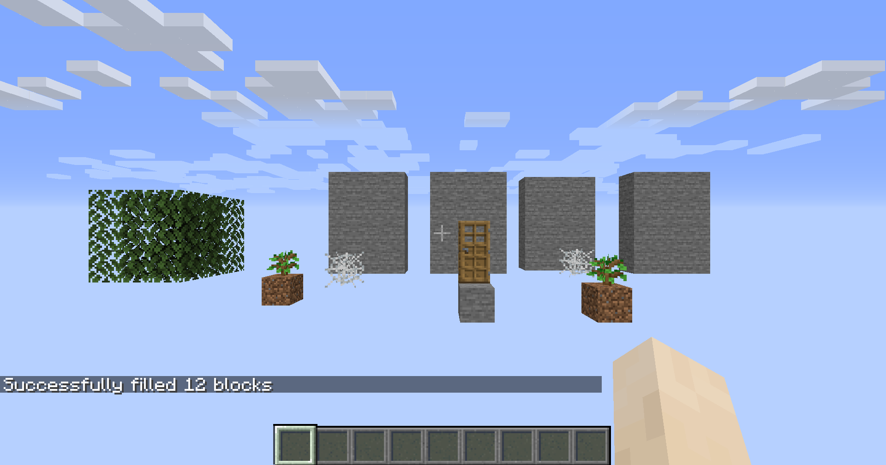
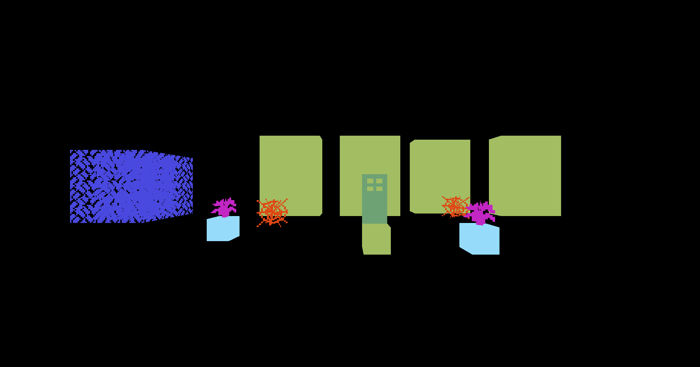
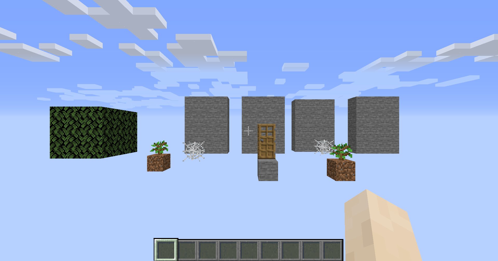
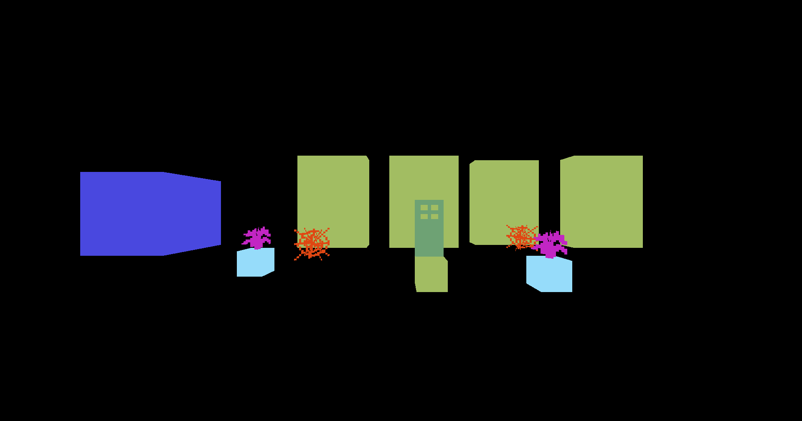

# Cutout-block semantic classes

**Verified outcome:** Semantic capture now supports Minecraft Java Edition 1.16.1's solid, cutout-mipped, and cutout block-model layers while preserving exact texture-shaped coverage and manifest-backed unsigned 16-bit identities.

| | |
| --- | --- |
| Status | Experimental successor milestone, verified within the scope described below |
| Target | Minecraft Java Edition 1.16.1 |
| Tested implementation | `89d87d999ffafcec51cb04c5125da41cb10fa99d` (`feat(semantic): capture cutout texture coverage`) |
| Manual verification | September 6, 2026 |
| Manifest | 763 entries; SHA-256 `37af04fd5db5f797773782b3b8396e0247c171bf8ad13e56e1408e22335f937b` |

## Question and progression

The [previous solid-block milestone](solid-block-semantic-classes.md) connected Minecraft's complete 763-entry block-identity vocabulary to ordinary solid chunk geometry. It produced exact `.classes.u16le` images, but cutout geometry remained unsupported.

Cutout blocks are harder than solid blocks because their model quads contain transparent texture areas. A sapling, for example, uses crossed rectangular quads whose visible stems and leaves occupy only part of each rectangle. Labeling the whole quad would create a false filled rectangle, hide blocks that should be visible through it, and no longer describe Minecraft's rendered image.

This experiment asked whether the same renderer-derived approach could preserve that per-texel coverage for Minecraft's solid, cutout-mipped, and cutout layers while keeping exact manifest identities and shared depth occlusion. The verified result answers that question affirmatively for representative ordinary block models in the tested client configuration. It does not complete the wider semantic-observation interface.

## How it works

During chunk tessellation, Minecraft's own `RenderLayers.getBlockLayer(state)` result determines whether a block contribution belongs to the solid, cutout-mipped, cutout, or an unsupported layer. The mod does not maintain a handwritten list of cutout blocks. For each vertex in a supported layer, it resolves the block's canonical registry identifier through the active runtime manifest and stores the low and high bytes of that stable class ID in a parallel vertex record.

That parallel record is the semantic sidecar: a second, compact stream associated with Minecraft's ordinary chunk vertices. It supplies identity without changing the positions, texture coordinates, colors, lighting, or other vertex data used for the normal RGB view.

An F8 capture replays the already selected chunk geometry into one off-screen semantic target in Minecraft 1.16.1's relevant order: solid, cutout-mipped, then cutout. The three passes share one depth buffer. Solid geometry therefore hides farther cutout geometry; a surviving nearer cutout fragment hides geometry behind it; and geometry behind a transparent cutout texel remains visible.

For cutout passes, the replay keeps Minecraft's block-atlas texture coordinates and samples atlas alpha. A narrowly scoped fixed-function texture-combine configuration takes RGB from the exact sidecar class bytes while taking only alpha from the block atlas. Minecraft's `GL_GREATER 0.5` alpha test discards transparent fragments. Texture RGB, block tint, lighting, fog, gamma, blending, dithering, and interpolation do not determine or modify the class ID. The cutout-mipped pass retains the renderer's applicable atlas sampling behavior.

The replay uses Minecraft's current geometry, camera projection, frustum-selected chunks, render distance, face culling, and depth relationships. It does not scan loaded blocks, reconstruct visibility from world coordinates, ray-cast across the scene, or infer identities with a vision model.

## Output contract

The machine-readable output remains `.classes.u16le`:

- two bytes per pixel;
- unsigned 16-bit class IDs in little-endian order;
- row-major pixels with a top-left origin;
- exact length `width × height × 2`;
- class `0` for background.

Capture metadata is now `semantic-observation-v3`. It records the three included semantic render layers, the current graphics mode, the block-atlas alpha source and threshold, capture dimensions, manifest identity, filenames, byte length, and only the positive classes observed in that frame. The false-color PNG remains a human inspection aid. Its colors are deterministic and carry no meaning about usefulness, importance, or strategy.

The 763-entry manifest is a complete identity vocabulary, not a claim that every registered block emits geometry through one of the three supported layers. Minecraft's renderer remains authoritative for whether a block state emits visible geometry and which layer receives it.

## Verification

The project pins Minecraft `1.16.1`, Yarn `1.16.1+build.21`, Fabric Loader `0.9.3+build.207`, Fabric Loom `1.11.8`, and the Gradle `8.14.3` wrapper. The mod targets Java 8 bytecode. The test scene used the pinned development client without a shader pack or renderer-replacement mod.

The scene combined opaque stone with oak saplings, oak leaves, cobwebs, and an oak door. One sapling stood behind an opaque stone wall, other cutout geometry had visible stone behind its transparent areas, and the graphics setting was changed from Fancy to Fast and back to Fancy before the camera was turned away. F2 screenshots and F8 semantic captures were saved at each meaningful state.

Representative verified identities were:

| Semantic class | Registry identifier | Diagnostic color |
| ---: | --- | --- |
| 143 | `minecraft:cobweb` | `#E04713` |
| 238 | `minecraft:dirt` | `#96DCFA` |
| 440 | `minecraft:oak_door` | `#6EA274` |
| 443 | `minecraft:oak_leaves` | `#4948DF` |
| 447 | `minecraft:oak_sapling` | `#C226C3` |
| 662 | `minecraft:stone` | `#A2BD62` |

These identities exercised one generic manifest-backed mechanism; they are not a handwritten support list, and the experiment did not render every manifest entry.

### Results

| Test | Verified result |
| --- | --- |
| Automated contracts | All 28 JUnit tests passed |
| Build outputs | Clean build and production remapping passed |
| Texture-shaped coverage | Saplings and cobwebs followed their visible texture silhouettes; transparent texels did not become filled model quads |
| Transparency holes | Stone remained visible through cutout openings |
| Door coverage | The tested oak-door region contained 8,532 class-`440` pixels and 852 class-`662` stone pixels visible through its openings |
| Solid occlusion | An opaque stone wall completely hid the second sapling |
| Occluder removal | Removing the wall revealed a new class-`447` connected component containing 2,049 pixels |
| Fancy to Fast | Exactly 10,157 pixels changed, all from background `0` to oak leaves `443` |
| Fast to Fancy | Exactly the same 10,157 pixels changed back from oak leaves `443` to background `0` |
| Rebuilt geometry | The restored-Fancy raw buffer was byte-for-byte identical to the earlier post-removal Fancy buffer |
| Behind-camera boundary | The final capture contained only background class `0` |
| Visualization | Every semantic PNG matched its decoded raw buffer with zero pixel mismatches |
| Manifest identity | Every capture reported 763 entries and the expected manifest fingerprint |
| RGB integrity | No F8 flash or visible corruption was observed during manual testing |

The restored-Fancy buffer's SHA-256 was:

```text
dacac733695d605c6d9eeaf568ce9b57d082d65e0e0704c3b5ba63149c4976b3
```

Capture 1 was `1920 × 1080`, producing `4,147,200` class-buffer bytes. Captures 2 through 5 were `1920 × 1009`, each producing `3,874,560` bytes. For every capture, the screenshot, semantic PNG, metadata, and raw buffer agreed internally with that capture's recorded dimensions. The evidence does not assume that all captures had the same dimensions.

Automated tests established layer classification and order, manifest-backed mapping, sidecar validation, exact unsigned 16-bit encoding, metadata version 3, fingerprint propagation, graphics-mode metadata, deterministic visualization colors, and failure on misleading sidecar or manifest mismatches. Launching the pinned client established runtime registry initialization, Mixin application, and capture production. Manual RGB/semantic comparisons and independent raw-buffer decoding established the texture silhouettes, depth behavior, graphics-mode transitions, exact IDs, and behind-camera result in this scene.

## Visual evidence

The Fancy baseline shows narrow sapling and cobweb silhouettes rather than their full model rectangles. Stone remains visible through texture openings, while the large foreground stone wall completely hides the second sapling.

| Normal Minecraft view | Semantic view |
| --- | --- |
|  |  |

After the foreground wall was removed, the newly exposed sapling appears in both images. Its new semantic component contains 2,049 class-`447` pixels and retains the texture-shaped gaps through which geometry behind it remains visible.

| Normal Minecraft view after removing the wall | Semantic view after removing the wall |
| --- | --- |
|  |  |

Fast graphics changes how Minecraft routes and renders oak leaves, but their canonical identity remains class `443`. Relative to the post-removal Fancy capture, only 10,157 background pixels became oak-leaves pixels.

| Fast-graphics Minecraft view | Fast-graphics semantic view |
| --- | --- |
|  |  |

After the camera turned 180 degrees away from the scene, all `1,937,280` semantic pixels were background.


## Vanilla Fabulous-mode environment note

High-severity OpenGL messages appeared while the Graphics button cycled through vanilla Fabulous mode on the tested AMD Radeon RX 7600 environment. A focused follow-up compared the cutout implementation both without and after F8 against an exact solid-only control. F8 was not required to reproduce the messages, and the solid-only control reproduced the same behavior.

Debug instrumentation found no errors after semantic sidecar allocation, upload, binding, or deletion, and no errors from the cutout texture-combine operation. Instead, Minecraft 1.16.1's vanilla Fabulous compositor selected its 12 sampler units and issued legacy fixed-function texture enable and disable calls. Units 8 through 11 exceeded the context's fixed-function texture-coordinate range, producing four `glEnable` and four `glDisable` `GL_INVALID_OPERATION` messages per composition. The observed totals matched this eight-error cadence exactly: `336 = 42 × 8`, `376 = 47 × 8`, and the original `776 = 97 × 8`.

The client remained visually functional, later semantic captures remained byte-correct, and manual testing found no RGB corruption. No vanilla Fabulous compatibility patch was added to this branch. This is a tested environment limitation, not evidence of a semantic-rendering failure or of general AMD incompatibility. Graphics-driver, cross-vendor, and cloud-renderer portability still require environment-specific smoke tests.

## What this establishes

Within the tested default-renderer configuration, a block-atlas alpha mask can be combined with a separate manifest-backed semantic sidecar without sacrificing exact unsigned 16-bit class identity. The resulting image follows the renderer's cutout texture coverage, supported-layer selection, camera boundary, and shared depth behavior while leaving Minecraft's normal RGB vertices unchanged.

This establishes the bounded technical feasibility of renderer-derived semantic output for representative solid and cutout block-model geometry. It does not establish comprehensive block coverage, production performance, broad renderer compatibility, or a complete agent-facing observation system.

## Limitations

This milestone still excludes translucent blocks, classified fluids, the separate tripwire layer, entities and dropped items, separately rendered block entities, particles, HUD, menus, inventory, F3, subtitles, lighting-based visibility suppression, object tables, and continuous real-time observation streaming.

Capture still uses synchronous GPU readback and file output. Performance has not been profiled. Shader packs and replacement renderers are unsupported, and broad cross-vendor or cloud-GPU validation has not been performed. A future continuous-capture design will require additional render-state restoration and performance testing even though the manual F8 captures were correct.

## Implementation map

| Responsibility | Relevant files |
| --- | --- |
| Semantic GPU transport and cutout alpha composition | [`SemanticGpuTransport.java`](../../src/main/java/io/github/minecraftaidiscovery/semantic/SemanticGpuTransport.java), [`SemanticClassEncoding.java`](../../src/main/java/io/github/minecraftaidiscovery/semantic/SemanticClassEncoding.java) |
| Supported semantic layers and their order | [`SemanticRenderLayer.java`](../../src/main/java/io/github/minecraftaidiscovery/semantic/SemanticRenderLayer.java), [`SemanticRenderPass.java`](../../src/main/java/io/github/minecraftaidiscovery/semantic/SemanticRenderPass.java) |
| Minecraft render-layer mapping | [`SemanticMinecraftRenderLayers.java`](../../src/main/java/io/github/minecraftaidiscovery/semantic/SemanticMinecraftRenderLayers.java) |
| Manifest-backed block-layer selection during tessellation | [`ChunkRebuildTaskMixin.java`](../../src/main/java/io/github/minecraftaidiscovery/semantic/mixin/ChunkRebuildTaskMixin.java), [`BlockClassVocabulary.java`](../../src/main/java/io/github/minecraftaidiscovery/semantic/manifest/BlockClassVocabulary.java) |
| Semantic sidecar construction and storage | [`BufferBuilderMixin.java`](../../src/main/java/io/github/minecraftaidiscovery/semantic/mixin/BufferBuilderMixin.java), [`SemanticVertexData.java`](../../src/main/java/io/github/minecraftaidiscovery/semantic/SemanticVertexData.java) |
| Sidecar upload and drawing | [`VertexBufferMixin.java`](../../src/main/java/io/github/minecraftaidiscovery/semantic/mixin/VertexBufferMixin.java) |
| Combined capture, output encoding, and metadata version 3 | [`SemanticCapture.java`](../../src/main/java/io/github/minecraftaidiscovery/semantic/SemanticCapture.java), [`SemanticCaptureMetadata.java`](../../src/main/java/io/github/minecraftaidiscovery/semantic/SemanticCaptureMetadata.java) |
| Renderer timing and F8 integration | [`WorldRendererMixin.java`](../../src/main/java/io/github/minecraftaidiscovery/semantic/mixin/WorldRendererMixin.java), [`KeyboardMixin.java`](../../src/main/java/io/github/minecraftaidiscovery/semantic/mixin/KeyboardMixin.java) |
| Layer, rendering, metadata, encoding, and sidecar tests | [`SemanticRenderLayerTest.java`](../../src/test/java/io/github/minecraftaidiscovery/semantic/SemanticRenderLayerTest.java), [`SemanticRenderPassTest.java`](../../src/test/java/io/github/minecraftaidiscovery/semantic/SemanticRenderPassTest.java), [`SemanticCaptureMetadataTest.java`](../../src/test/java/io/github/minecraftaidiscovery/semantic/SemanticCaptureMetadataTest.java), [`SemanticClassEncodingTest.java`](../../src/test/java/io/github/minecraftaidiscovery/semantic/SemanticClassEncodingTest.java), [`SemanticVertexDataTest.java`](../../src/test/java/io/github/minecraftaidiscovery/semantic/SemanticVertexDataTest.java) |
| Manifest and canonical-vocabulary tests | [`BlockClassManifestTest.java`](../../src/test/java/io/github/minecraftaidiscovery/semantic/manifest/BlockClassManifestTest.java), [`BlockClassVocabularyTest.java`](../../src/test/java/io/github/minecraftaidiscovery/semantic/manifest/BlockClassVocabularyTest.java) |
