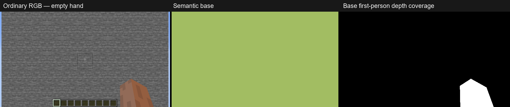
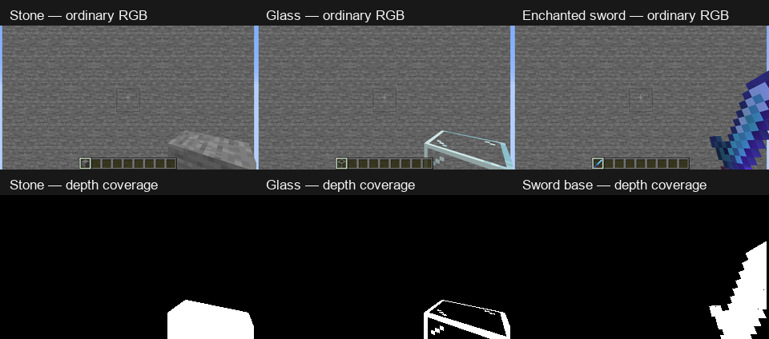
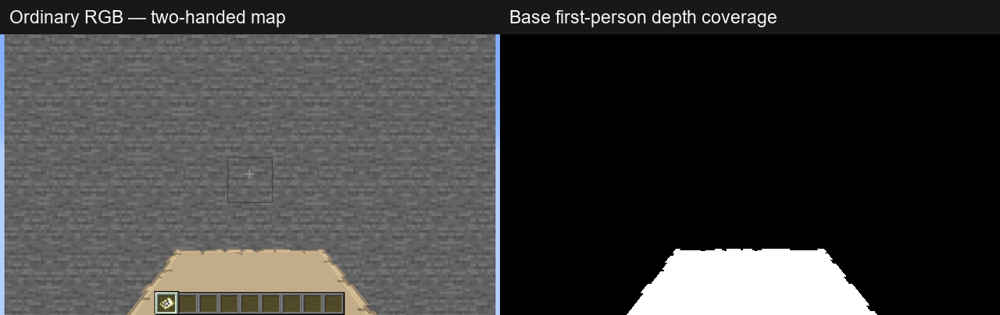
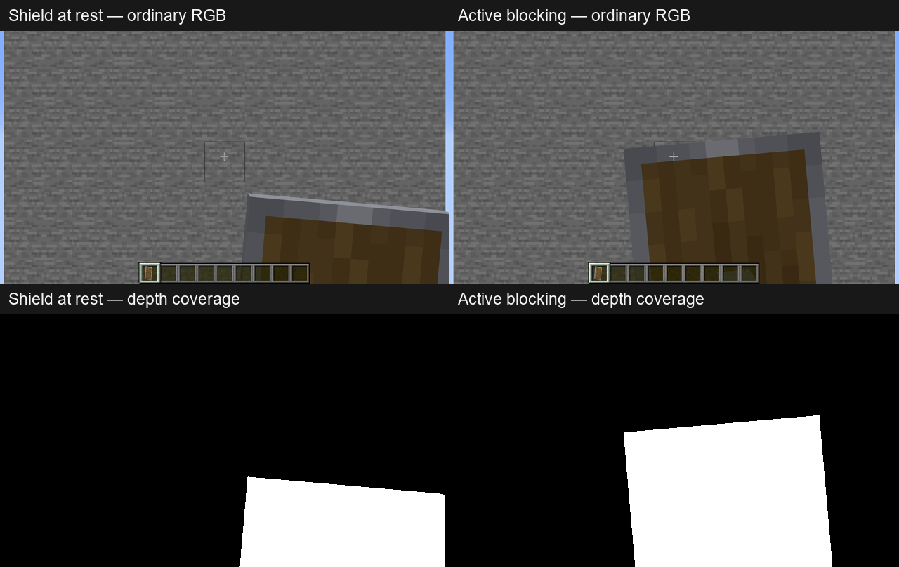
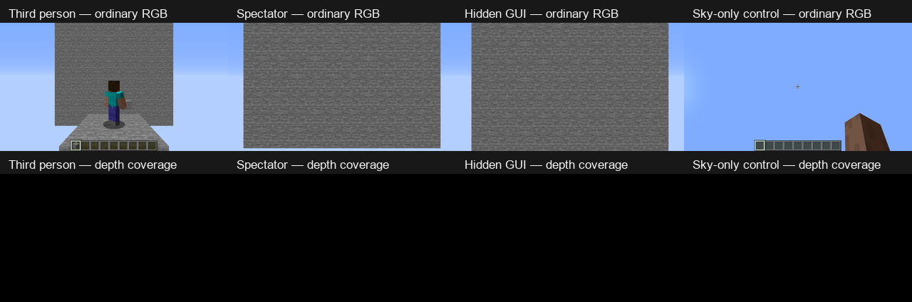

# First-person depth-coverage diagnostic probe

**Verified outcome:** Minecraft Java Edition 1.16.1's post-hand depth buffer can provide an
aligned, researcher-only measurement of where first-person hands and held items wrote depth over
the opaque/cutout semantic base. The diagnostic uses the original render result, does not identify
the hand or item, and leaves ordinary RGB and F8 output unchanged.

| | |
| --- | --- |
| Status | Experimental researcher diagnostic, verified within the scope below |
| Target | Minecraft Java Edition 1.16.1 |
| Tested implementation | `44c56feafd702b0f87b91b22971fe1270703d22b` (`feat(first-person): capture depth coverage`) |
| Manual verification | September 13, 2026 |
| Probe format | `translucent-observation-probe-v5`, fixed `640 × 360` |
| Ordinary F8 format | `semantic-observation-v3`, unchanged |

## Question

Minecraft draws first-person arms and held items after the world. The existing semantic base is
derived from opaque and cutout terrain, so it can retain an exact block identity even where an
arm, map, shield, or item covers the ordinary view. Passing that identity through unchanged could
create privileged vision.

This experiment asked whether the renderer itself provides a bounded measurement of that overlap
without rerunning item rendering, querying player or world state again, or serializing the held
item. It was designed to gather evidence, not to define an agent-visible occlusion policy.

## Renderer boundary and measured quantity

Immediately before first-person rendering, Minecraft clears the main depth buffer to `1.0` while
leaving the already rendered world color intact. The first-person renderer then draws and flushes
eligible arms, sleeves, maps, and held-item geometry. Camera overlays such as underwater and fire
are drawn afterward.

The existing camera-overlay diagnostic already copies this post-hand depth buffer into its fixed
`640 × 360` target before mirroring any overlay. Version 5 reads that copied depth once at the same
boundary. A finite sample below the exact clear value means that depth-writing first-person
geometry reached that sample. No second depth transfer, geometry replay, or player/world query is
performed.

The resulting `base.first-person-depth-coverage.u8` stores one unsigned byte per pixel:

- `255` means first-person rendering wrote depth at that sample;
- `0` means it did not, or the separate semantic base is background.

Only positive solid, cutout-mipped, or cutout base pixels retain the binary result. The metadata
also records an unmasked full-screen coverage count so researchers can check boundaries without
publishing raw depth. OpenGL's bottom-up readback is converted to the established top-left F9
pixel order.

This is **depth-write coverage**, not opacity, retained RGB, semantic identity, or a perceptual
visibility score. A blended translucent item can write depth without fully replacing the world
color. Conversely, color-only glint or decorative layers need not create additional depth. The
field contains no hand side, skin, item stack, item or texture identity, UV, use flag, model, or
raw depth value.

The probe remains disabled by default and is available only through the opt-in F9 researcher
capture. It is not included in ordinary F8 output.

## Controlled verification

The manual matrix used Fancy graphics, vanilla resources, no post shader, a fixed window, and a
stone wall with a fixed first-person camera. F2 screenshots were captured immediately before F9
as visual references; the semantic base and depth field themselves come from the same F9 frame.
Seven wall-facing captures varied only the first-person rendering: empty hand, stone, glass, a
two-handed map, an enchanted sword, a shield at rest, and the active blocking pose. Third-person,
spectator, hidden-GUI, and corrected sky-only captures tested the lifecycle and base-mask
boundaries. An initial upward-view control still contained an edge of the wall and was excluded
and replaced rather than misreported as background-only.

| Condition | Post-hand sample | Full-screen covered pixels | Covered base pixels |
| --- | --- | ---: | ---: |
| Empty hand | Yes | 10,139 | 10,139 |
| Stone | Yes | 17,310 | 17,167 |
| Glass | Yes | 5,651 | 5,508 |
| Two-handed map | Yes | 21,367 | 21,367 |
| Enchanted sword | Yes | 19,733 | 18,728 |
| Shield at rest | Yes | 34,062 | 33,450 |
| Shield actively blocking | Yes | 57,353 | 57,353 |
| Third-person back view | No | 0 | 0 |
| Spectator, first-person camera | Yes | 0 | 0 |
| Hidden GUI | Yes | 0 | 0 |
| Sky-only semantic base | Yes | 10,139 | 0 |

The first seven captures had byte-identical base-class buffers with 226,080 positive base pixels,
so their differing coverage came from the first-person draw. The silhouettes followed the
ordinary arm and item poses. The translucent glass control produced coverage for its
depth-writing visible fragments rather than a solid rectangle. Active blocking expanded the
shield footprint substantially compared with the unplanned but useful shield-at-rest control.

Third person correctly skipped the sampled overlay boundary. Spectator and hidden-GUI rendering
entered that boundary but produced no hand/item depth. In the corrected sky control, the ordinary
arm still produced 10,139 unmasked depth samples, but the semantic base contained no positive
pixels; the serialized base-masked field was therefore entirely zero.

Every successful version-5 directory contained all 20 expected files. Each new raw field was
exactly 230,400 bytes and contained only `0` and `255`. Every declared artifact length matched its
file, every coverage PNG decoded pixel-for-pixel to the corresponding raw buffer, and no
background-class pixel contained nonzero serialized coverage. Lighting remained valid with zero
unsupported base pixels, translucent storage did not overflow, and the existing F9 fields were
preserved.

The baseline F8 capture remained `semantic-observation-v3` with its expected unsigned 16-bit class
buffer. Log inspection found no capture failure, exception, OpenGL error, or framebuffer error.
No flash, stale image, RGB corruption, crash, or other rendering disturbance was observed during
captures or subsequent movement.

## Visual evidence

White in the depth panels means a post-hand depth write intersected a positive semantic-base
pixel. Black means no such intersection; it is not a probability of recognition and does not
authorize disclosure or suppression of the underlying identity.

*The empty arm is absent from the terrain-only semantic base but creates an aligned depth-write
footprint over the wall. The false-color base identifies valid terrain pixels; it is not RGB.*

*Stone and the sword produce item-shaped binary footprints. Glass demonstrates the central
limitation: depth coverage follows its surviving rendered fragments but does not claim full RGB
replacement. The enchanted glint is not measured separately from the sword's depth-writing base.*

*The two-handed map produces a broad centered footprint from the original map and arm rendering.
No map data or item identity is serialized by the diagnostic.*

*The field follows Minecraft's actual pose: active blocking expands the covered-base count from
33,450 to 57,353 pixels. This is geometric depth coverage, not an estimate of recognizability.*

*Third person has no post-hand sample. Spectator and hidden-GUI paths are sampled but contain no
first-person depth writes. The sky control visibly contains an arm, yet its saved field is black
because the semantic base is entirely background.*

## Automated verification

All 95 tests across 25 suites passed with no failures, errors, skips, or omissions. Focused tests
cover exact dimensions and buffer length, binary values, OpenGL row orientation, positive-base
masking, immutable results, no-stage behavior, rejection of invalid depth and coverage, the exact
`1.0` clear-depth invariant, state restoration on success and failure, version-5 metadata, and
preservation of ordinary F8 metadata.

The clean test, build, and production-remapping workflow passed. The remapped JAR contained the
new data-contract and integrated capture classes, and Minecraft 1.16.1 reached the title screen
with the diagnostic enabled before the manual in-world matrix.

## Limitations and unresolved policy

The implementation supports the verified Fast and Fancy path with vanilla resources, no active
post shader, GL 3.0 depth transfer, and the normal `1.0` depth clear. Fabulous graphics,
replacement resources, shaders, a missing or incompatible depth attachment, invalid readback, and
unexpected render state fail rather than silently substituting a geometric approximation.

The copied depth is nearest-scaled from the native window framebuffer. It is aligned to the F9
buffers, but it does not claim that independently rasterizing the hand at `640 × 360` would
produce identical edge samples. Resource packs can change texture alpha and therefore which
fragments write depth, so compatibility beyond vanilla resources needs separate evidence.

Depth does not encode blend transmission, texture contrast, lighting, source color, or later
color-only layers. The probe does not cover third-person character occlusion, camera overlays,
fog, world translucency, entities, particles, weather, HUD, menus, or post-processing; existing
F9 fields study some of those effects separately. It adds a synchronous `640 × 360` float
readback to a one-shot diagnostic, and continuous-capture performance has not been measured.

No decision has been made about whether hands and held items should become agent-visible objects,
act only as occluders, or be excluded from a future observation contract. No visibility threshold
or semantic-suppression rule has been selected. The exact coverage and counts remain
researcher-only.

## Reproduction

Launch the pinned client with `./gradlew runClient -PtranslucentProbe=true` or the Windows wrapper
equivalent, use vanilla resources with Fast or Fancy graphics and no post shader, and press F9
in-world. A successful capture writes `translucent-observation-probe-v5`, including
`base.first-person-depth-coverage.u8` and its grayscale PNG. F8 separately remains
`semantic-observation-v3`.

Useful controls pair F2 and F9 while viewing fixed opaque terrain with an empty hand, opaque and
translucent items, a filled map, an enchanted item, and a sustained use pose. Third-person,
spectator, hidden-GUI, and all-background views establish the lifecycle and masking boundaries.
Movement after each capture checks for transient rendering disturbance.

## Implementation map

| Responsibility | Relevant files |
| --- | --- |
| Opt-in configuration and F9 activation | [`build.gradle`](../../build.gradle), [`TranslucentProbeConfiguration.java`](../../src/main/java/io/github/minecraftaidiscovery/semantic/translucent/TranslucentProbeConfiguration.java), [`TranslucentProbeCaptureRequests.java`](../../src/main/java/io/github/minecraftaidiscovery/semantic/translucent/TranslucentProbeCaptureRequests.java), [`KeyboardMixin.java`](../../src/main/java/io/github/minecraftaidiscovery/semantic/mixin/KeyboardMixin.java) |
| Same-frame terrain preparation and post-hand completion | [`WorldRendererMixin.java`](../../src/main/java/io/github/minecraftaidiscovery/semantic/mixin/WorldRendererMixin.java), [`InGameOverlayRendererMixin.java`](../../src/main/java/io/github/minecraftaidiscovery/semantic/mixin/InGameOverlayRendererMixin.java), [`GameRendererMixin.java`](../../src/main/java/io/github/minecraftaidiscovery/semantic/mixin/GameRendererMixin.java), [`CameraOverlayRetentionCapture.java`](../../src/main/java/io/github/minecraftaidiscovery/semantic/overlay/CameraOverlayRetentionCapture.java) |
| Post-hand depth copy, readback, and GL state restoration | [`CameraOverlayRetentionGpuTransport.java`](../../src/main/java/io/github/minecraftaidiscovery/semantic/overlay/CameraOverlayRetentionGpuTransport.java) |
| Binary validation, top-left conversion, masking, and result lifecycle | [`FirstPersonDepthCoverageEncoding.java`](../../src/main/java/io/github/minecraftaidiscovery/semantic/firstperson/FirstPersonDepthCoverageEncoding.java), [`FirstPersonDepthCoverageResult.java`](../../src/main/java/io/github/minecraftaidiscovery/semantic/firstperson/FirstPersonDepthCoverageResult.java) |
| Version-5 serialization, visualization, and metadata | [`TranslucentProbeCapture.java`](../../src/main/java/io/github/minecraftaidiscovery/semantic/translucent/TranslucentProbeCapture.java), [`TranslucentProbeMetadata.java`](../../src/main/java/io/github/minecraftaidiscovery/semantic/translucent/TranslucentProbeMetadata.java) |
| Focused behavior and schema tests | [`FirstPersonDepthCoverageEncodingTest.java`](../../src/test/java/io/github/minecraftaidiscovery/semantic/firstperson/FirstPersonDepthCoverageEncodingTest.java), [`FirstPersonDepthCoverageResultTest.java`](../../src/test/java/io/github/minecraftaidiscovery/semantic/firstperson/FirstPersonDepthCoverageResultTest.java), [`CameraOverlayRetentionGpuTransportTest.java`](../../src/test/java/io/github/minecraftaidiscovery/semantic/overlay/CameraOverlayRetentionGpuTransportTest.java), [`TranslucentProbeMetadataTest.java`](../../src/test/java/io/github/minecraftaidiscovery/semantic/translucent/TranslucentProbeMetadataTest.java), [`SemanticCaptureMetadataTest.java`](../../src/test/java/io/github/minecraftaidiscovery/semantic/SemanticCaptureMetadataTest.java) |
