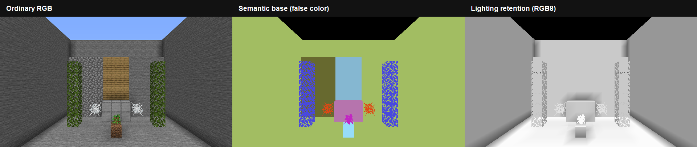
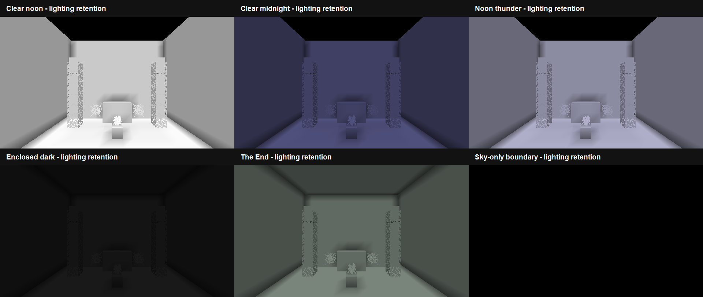
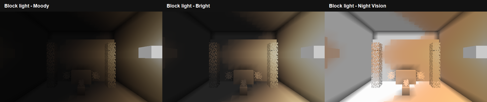

# Lighting-retention diagnostic probe

**Verified outcome:** Minecraft Java Edition 1.16.1's renderer can provide an aligned,
researcher-only measurement of the lighting applied to supported opaque and cutout base
geometry. The measurement responds to the active lightmap and renderer shading inputs without
changing normal rendering or the ordinary semantic observation contract.

| | |
| --- | --- |
| Status | Experimental researcher diagnostic, verified within the scope below |
| Target | Minecraft Java Edition 1.16.1 |
| Tested implementation | `d31b95f3cb34eb11b30f5d97a8b2dbc2d985b381` (`feat(probe): add renderer lighting retention diagnostic`) |
| Manual verification | September 12, 2026 |
| Probe format | `translucent-observation-probe-v3`, fixed `640 × 360` |
| Ordinary F8 format | `semantic-observation-v3`, unchanged |

## Question

The semantic renderer can retain an exact block identity even when Minecraft's ordinary view
is extremely dark. Giving that identity to an agent without qualification could create
privileged vision: the observation could identify geometry that the displayed image does not
make meaningfully recognizable.

This experiment asked a narrower question than deciding visibility: can the renderer's actual
lighting contribution be measured for the same opaque and cutout base pixels, without scanning
world state, changing normal RGB rendering, or choosing an agent-facing threshold? The result is
yes for the supported block-model path. It is a diagnostic measurement, not a rule for revealing
or suppressing semantic identity.

## Minecraft's lighting path

For each block-model quad, Minecraft 1.16.1 emits geometry and texture coordinates together with
packed sky/block lightmap coordinates. The block renderer also supplies a per-vertex multiplier
for ambient occlusion and directional face shading. Smooth lighting can give the four corners
different values.

Minecraft updates a small active lightmap texture before world rendering. That texture combines
the dimension's lighting behavior with sky and block light, time of day, weather, the ordinary
brightness setting, and effects such as Night Vision. During terrain rendering, the GPU samples
the lightmap at the emitted coordinates and combines it with the interpolated renderer
multiplier, block texture, and tint. Fog is applied later, followed by translucent composition
and other rendering stages.

## What the diagnostic measures

The F9 probe replays Minecraft's already selected solid, cutout-mipped, and cutout block-model
geometry. It samples the currently active lightmap at Minecraft's emitted coordinates and
multiplies that RGB response by the renderer's ambient-occlusion/directional value. The result is
stored as three unsigned bytes per pixel in `base.lighting-retention.rgb8`. A separate validity
byte is `255` only where a positive semantic base pixel came from the supported renderer path.

This quantity deliberately differs from several related observations:

| Quantity | Difference from lighting retention |
| --- | --- |
| Semantic class identity | Names the winning rendered block contribution; it does not say how strongly that surface was lit. |
| Texture color | Surface texture, baked color, and biome tint are excluded from the diagnostic RGB. Atlas alpha is used only to preserve cutout coverage. |
| Fog retention | Remains a separate F9 channel measured from Minecraft's active fog path. Lighting capture disables fog. |
| Ordinary RGB brightness | The displayed image combines texture, tint, lighting, fog, translucency, and later effects; this diagnostic isolates only the supported lighting term. |
| Perceptual visibility | Recognition also depends on texture contrast, neighboring pixels, spatial context, display response, and human or model perception. |

The diagnostic intensity is therefore neither a probability of correct recognition nor
authorization to expose an exact class. No threshold is applied, and the exact values remain
researcher-only. The probe is disabled by default and is not part of the agent observation.

## Alignment with the semantic base

The lighting replay uses the same `640 × 360` target and renderer-selected geometry as the F9
base. It copies the base depth and accepts only fragments at exactly the winning base depth.
Cutout layers reuse the block atlas's alpha test, so transparent texels do not become filled
quads. Background pixels remain invalid and zero. Geometry that did not pass through the
supported block-model lighting hook is marked unsupported rather than assigned an approximation.

*The three panels show the same camera and scene. The 1920 × 1080 ordinary screenshot was
resized to the probe panel dimensions for presentation; the other panels are direct 640 × 360
diagnostic visualizations. The center panel is deterministic false-color semantic identity;
the right panel is lighting retention. Neither diagnostic color nor brightness estimates
recognizability or decides whether the identity may be agent-visible.*

## Controlled verification

The manual matrix used the vanilla resource pack, Fancy graphics, smooth lighting, no post
shader, fixed `640 × 360` probe output, and paired ordinary screenshots. Geometry and camera were
kept fixed wherever the tested condition allowed it. The sequence covered clear noon, a repeated
noon control, clear midnight, noon thunder, enclosed darkness, a controlled block-light source at
the Moody and Bright settings, Night Vision, matching roofed geometry in the End, and an all-sky
boundary. Each condition was captured with F9; one ordinary F8 capture checked the existing
contract.

All ten F9 captures were complete and reported lighting status `valid`, with zero unsupported
base pixels. The two daylight captures were byte-identical across base classes, lighting
validity, fog retention, and lighting-retention RGB. Day, night, and thunder retained identical
base, validity, and fog buffers while every valid lighting pixel changed coherently. The dark
Overworld and End scenes retained identical base and validity buffers, but produced distinct
dimension lighting. The sky-only capture contained no positive base, no valid lighting pixel,
and an all-zero lighting buffer.

*Every panel is lighting retention, not ordinary RGB. The top-row geometry remained fixed;
clear midnight was darker than noon and thunder fell between them. The enclosed Overworld and
End panels share fixed semantic geometry. The black sky panel means no supported base pixel was
present, not that the sky has a measured lighting value.*

The controlled block-light captures retained byte-identical base, validity, and fog buffers.
Bright raised the dim lightmap response relative to Moody without making any supported pixel
darker, and Night Vision raised it more strongly. Smooth spatial variation remained visible.

*All three panels use the same semantic geometry and block-light arrangement. Only the active
lighting state changes. Higher diagnostic intensity does not by itself justify exposing exact
identity.*

Automated verification covered exact buffer lengths, unsigned-byte bounds, deterministic
lightmap/multiplier reconstruction, four-corner smooth-lighting data, invalid-source guards,
metadata validity and partial states, separation from fog, default-disabled configuration, and
the unchanged F8 schema. All 73 tests passed. The clean build and production remapping also
passed, and the remapped JAR contained the expected mixins and lighting classes. The pinned client
reached the title screen and completed the full manual sequence without a capture failure,
rendering disturbance, crash, or probe-specific error.

## Limitations and unresolved policy

The diagnostic covers positive base pixels emitted through the ordinary block-model path.
Fluid-rendered base geometry is unsupported because that renderer does not provide the same
per-quad multiplier input. Fast and Fancy vanilla fixed-function terrain are supported; Fabulous
graphics, non-vanilla resource packs, active post shaders, and nonstandard lightmap state fail
closed. The experiment was run in one development environment and is not a broad driver or
renderer-compatibility result.

Lighting alone does not determine whether a block is recognizable. Texture contrast still
matters. Fog, translucent surfaces, full-screen overlays, hand rendering, HUD elements, and other
later effects remain separate. No visibility threshold has been selected. Whether lighting
should influence an eventual agent-facing policy, how it should combine with those other factors,
and whether an obscured/unknown result is appropriate all remain unresolved. This report does not
approve any agent-visible lighting values or semantic suppression rule.

## Reproduction

Launch the pinned development client with `./gradlew runClient -PtranslucentProbe=true` (or the
Windows wrapper equivalent), use the vanilla resource pack with Fast or Fancy graphics and no
post shader, then press F9 in-world. Successful captures write the version-3 researcher probe;
F8 independently continues to write `semantic-observation-v3`. Reproduction should compare
fixed geometry across controlled lighting changes and treat a nonzero unsupported count as a
partial result rather than darkness.

## Implementation map

| Responsibility | Relevant files |
| --- | --- |
| Startup configuration and F9 activation | [`build.gradle`](../../build.gradle), [`TranslucentProbeConfiguration.java`](../../src/main/java/io/github/minecraftaidiscovery/semantic/translucent/TranslucentProbeConfiguration.java), [`TranslucentProbeCaptureRequests.java`](../../src/main/java/io/github/minecraftaidiscovery/semantic/translucent/TranslucentProbeCaptureRequests.java), [`KeyboardMixin.java`](../../src/main/java/io/github/minecraftaidiscovery/semantic/mixin/KeyboardMixin.java) |
| Captured lighting state and diagnostic parameter representation | [`LightingRetentionCaptureContext.java`](../../src/main/java/io/github/minecraftaidiscovery/semantic/lighting/LightingRetentionCaptureContext.java), [`LightingRetentionBufferEncoding.java`](../../src/main/java/io/github/minecraftaidiscovery/semantic/lighting/LightingRetentionBufferEncoding.java) |
| Renderer multiplier capture and sidecar storage | [`BlockModelRendererMixin.java`](../../src/main/java/io/github/minecraftaidiscovery/semantic/mixin/BlockModelRendererMixin.java), [`LightingRetentionVertexEncoding.java`](../../src/main/java/io/github/minecraftaidiscovery/semantic/lighting/LightingRetentionVertexEncoding.java), [`LightingRetentionVertexData.java`](../../src/main/java/io/github/minecraftaidiscovery/semantic/lighting/LightingRetentionVertexData.java), [`BufferBuilderMixin.java`](../../src/main/java/io/github/minecraftaidiscovery/semantic/mixin/BufferBuilderMixin.java) |
| GPU upload, active-lightmap replay, and state restoration | [`VertexBufferMixin.java`](../../src/main/java/io/github/minecraftaidiscovery/semantic/mixin/VertexBufferMixin.java), [`LightingRetentionGpuTransport.java`](../../src/main/java/io/github/minecraftaidiscovery/semantic/lighting/LightingRetentionGpuTransport.java), [`LightingRetentionRenderPass.java`](../../src/main/java/io/github/minecraftaidiscovery/semantic/lighting/LightingRetentionRenderPass.java) |
| Capture timing, alignment, serialization, visualization, and metadata | [`WorldRendererMixin.java`](../../src/main/java/io/github/minecraftaidiscovery/semantic/mixin/WorldRendererMixin.java), [`TranslucentProbeCapture.java`](../../src/main/java/io/github/minecraftaidiscovery/semantic/translucent/TranslucentProbeCapture.java), [`TranslucentProbeMetadata.java`](../../src/main/java/io/github/minecraftaidiscovery/semantic/translucent/TranslucentProbeMetadata.java) |
| Focused lighting, validity, metadata, configuration, and F8-contract tests | [`LightingRetentionBufferEncodingTest.java`](../../src/test/java/io/github/minecraftaidiscovery/semantic/lighting/LightingRetentionBufferEncodingTest.java), [`LightingRetentionCaptureContextTest.java`](../../src/test/java/io/github/minecraftaidiscovery/semantic/lighting/LightingRetentionCaptureContextTest.java), [`LightingRetentionVertexDataTest.java`](../../src/test/java/io/github/minecraftaidiscovery/semantic/lighting/LightingRetentionVertexDataTest.java), [`TranslucentProbeMetadataTest.java`](../../src/test/java/io/github/minecraftaidiscovery/semantic/translucent/TranslucentProbeMetadataTest.java), [`TranslucentProbeConfigurationTest.java`](../../src/test/java/io/github/minecraftaidiscovery/semantic/translucent/TranslucentProbeConfigurationTest.java), [`SemanticCaptureMetadataTest.java`](../../src/test/java/io/github/minecraftaidiscovery/semantic/SemanticCaptureMetadataTest.java) |
