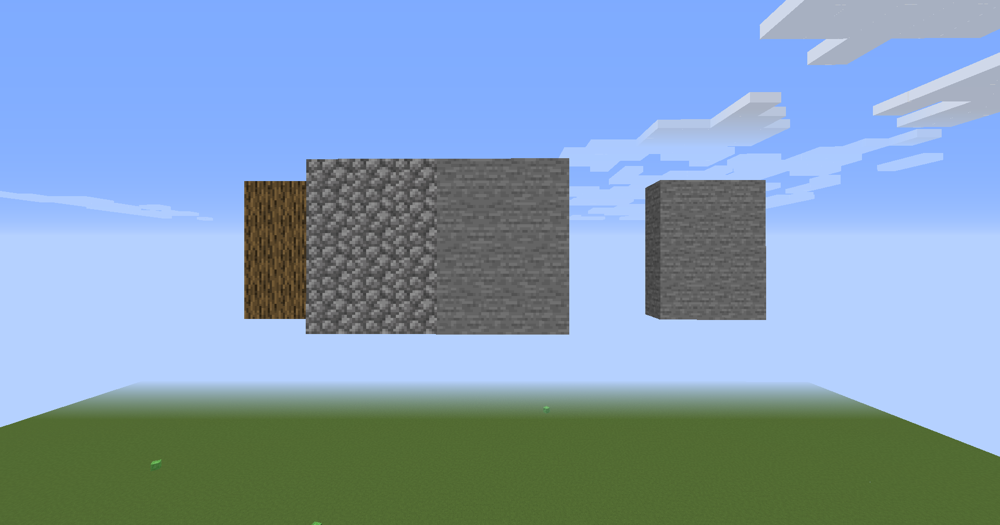
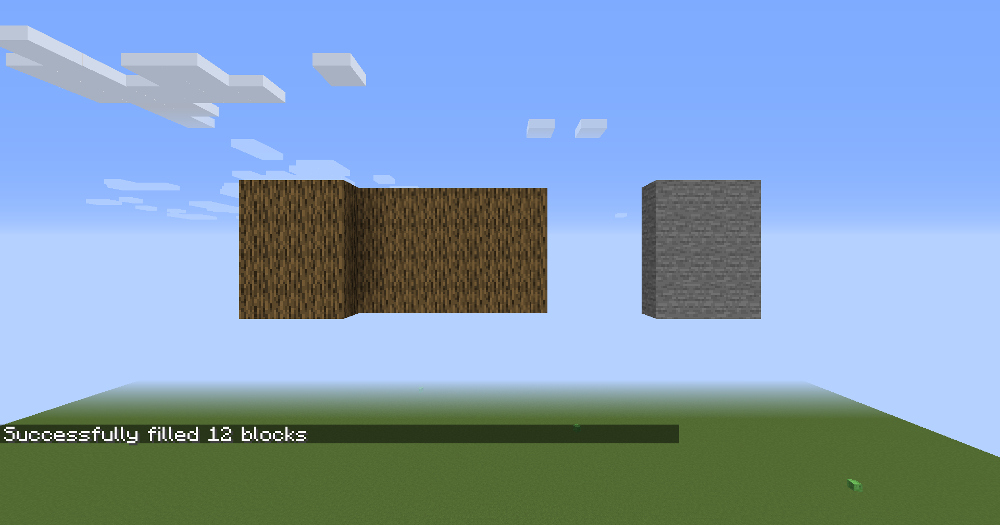

# Semantic observation proof of concept

| | |
| --- | --- |
| Status | Experimental proof of concept, verified within the scope described below |
| Target | Minecraft Java Edition 1.16.1 |
| Tested implementation | `44aca255227bf29551bb933bcc8e522c14b35b6b` (`feat(renderer): add opaque-block semantic capture`) |
| Manual verification | September 4, 2026 |

## Question

Can the actual Minecraft 1.16.1 client renderer produce a camera-aligned semantic class image for ordinary opaque blocks while retaining the renderer's view selection and depth occlusion?

This experiment answers that narrow question affirmatively for two block identities in the tested configuration. It is evidence that renderer-derived semantic observation is technically viable; it is not a complete observation interface.

## Implementation

The client-only Fabric mod assigns stable one-byte class identifiers to two exact block registry identities:

| Class | Registry identity | False color |
| ---: | --- | --- |
| 1 | `minecraft:stone` | red (`#E63946`) |
| 2 | `minecraft:oak_log` | teal (`#2A9D8F`) |

During Minecraft's normal solid-chunk rebuild, a mixin brackets the existing call that renders each block. Another mixin writes a provisional marker into the alpha byte of the vertices emitted by that call. The marker therefore originates at an actual rendered block contribution, not from a separate scan of loaded chunks.

Pressing F8 queues a capture after the normal solid terrain pass. The mod replays Minecraft's already-built solid-layer buffers into an off-screen RGBA8 framebuffer with a fresh depth attachment, using the current projection, camera-relative transform, visible-chunk selection, and ordinary depth testing. It reads the rendered marker at each pixel and emits:

- a row-major, top-left-origin unsigned-byte class buffer;
- JSON metadata containing dimensions, class mappings, and pixel counts; and
- a false-color PNG for inspection.

Unsupported solid blocks decode as background class 0 but still write depth. This is important: an unsupported opaque surface can hide a classified surface without exposing its own identity. The capture does not iterate through loaded chunks, ray-cast through the world, or export unrestricted world state.

The alpha-marker mechanism is deliberately provisional. It was chosen to test whether per-contribution identity survives Minecraft's existing chunk-buffer and terrain-render path, not as a permanent observation contract.

## Test configuration

The project pins Minecraft 1.16.1, Yarn `1.16.1+build.21`, Fabric Loader `0.9.3+build.207`, Fabric Loom `1.11.8`, and the Gradle 8.14.3 wrapper. The mod is compiled to Java 8 bytecode. The verified client ran on Windows 11 with Minecraft 1.16.1 under Java 8, the default renderer, and no other gameplay, shader, or renderer-replacement mods.

The manual scene was created in a Creative superflat world with cheats enabled. The camera was placed in spectator mode at the test origin, facing south. Three rear panels were constructed from oak logs. A stone panel covered one rear oak panel, while an unsupported cobblestone panel covered another. Separate visible stone and oak panels provided reference silhouettes.

The reproducible scene sequence was:

1. Launch the client with `.\gradlew.bat runClient`, create a Creative superflat world, and switch to spectator mode.
2. Teleport to the test origin before editing the scene and wait for the nearby chunks to load.
3. Fix daylight and weather, clear the test volume, and construct the stone, oak-log, and cobblestone panels:

   ```text
   /gamemode spectator
   /tp @s 0.5 65 0.5 0 0
   /time set noon
   /weather clear
   /gamerule doDaylightCycle false
   /fill -8 64 7 8 70 13 air
   /fill -7 65 10 -5 68 10 minecraft:stone
   /fill 5 65 10 7 68 10 minecraft:oak_log[axis=y]
   /fill -1 65 8 1 68 8 minecraft:stone
   /fill -1 65 11 1 68 11 minecraft:oak_log[axis=y]
   /fill 2 65 8 4 68 8 minecraft:cobblestone
   /fill 2 65 11 4 68 11 minecraft:oak_log[axis=y]
   ```

   An already-empty test volume may report `No blocks were filled`; that does not indicate a failure.

4. Press F2 for the normal Minecraft screenshot, then F8 for the semantic capture.
5. Remove the foreground stone panel with `/fill -1 65 8 1 68 8 air` and repeat the captures.
6. Remove the foreground cobblestone panel with `/fill 2 65 8 4 68 8 air` and repeat the captures.
7. Rotate the camera 180 degrees with `/tp @s 0.5 65 0.5 180 0` and repeat the captures.

The evaluated captures were 1920 by 1009 pixels. Each raw class buffer contained the expected 1,937,280 bytes.

## Results

| Check | Evidence | Result |
| --- | --- | --- |
| Stable class contract | Unit tests for registry IDs, unique marker round trips, and nested marker restoration | Passed: 3 tests, 0 failures |
| Build and remapping | Source generation, test, build, and production-name remapping; mixins and refmap inspected in the output JAR | Passed |
| Actual-client startup | Minecraft 1.16.1 reached the title screen with Fabric Loader 0.9.3 and the mixin subsystem active | Passed |
| Camera alignment | Paired normal and semantic frames had corresponding stone and oak silhouettes | Passed by manual inspection |
| Supported occlusion | Foreground stone produced red semantics and prevented the rear oak from producing teal pixels; removing it revealed the rear oak | Passed by manual inspection |
| Unsupported occlusion | Foreground cobblestone remained class 0 but prevented the rear oak from appearing; removing it revealed the oak | Passed by manual inspection |
| Behind-camera exclusion | After a 180-degree turn, the constructed panels were absent from the normal view and both semantic class counts were zero | Passed by manual inspection |

The automated tests establish the deterministic encoding and thread-local marker behavior. The build establishes compilation and remapping, and the startup test establishes compatibility with the actual 1.16.1 client. Those checks do not establish image correctness. Alignment, visibility, and occlusion were established by inspecting paired captures from the running client and by comparing the capture metadata.

## Visual evidence

In the baseline, the left oak panel appears teal and the visible stone surfaces appear red. The unsupported cobblestone face is black in the semantic view. Neither rear oak surface leaks through its foreground stone or cobblestone occluder.

| Normal Minecraft view | Semantic view |
| --- | --- |
|  |  |

Removing only the foreground stone revealed the oak behind it: oak coverage rose to 80,963 pixels while the unsupported cobblestone continued to hide the other rear oak panel. The remaining stone coverage was 60,785 pixels.


After the cobblestone was also removed, the second rear oak surface became visible in both views. Stone coverage remained exactly 60,785 pixels while oak coverage rose from 80,963 to 148,268 pixels. The unchanged stone count helps isolate the increase to newly visible oak rather than a class reassignment.

| Normal Minecraft view | Semantic view |
| --- | --- |
|  |  |

Finally, rotating the camera away from the constructed scene produced an all-background semantic image. Both supported-class pixel counts were zero, demonstrating that the test blocks did not remain observable merely because their chunks were loaded.


## What this establishes

Within the tested default-renderer configuration, exact block registry identity can be attached to real solid-block render contributions and recovered as a camera-aligned per-pixel class image. The experiment also shows that ordinary solid-geometry depth occlusion applies to both supported and unsupported opaque blocks, and that geometry outside the current camera view is excluded.

The approach structurally inherits the current projection, field of view, frustum-selected chunk buffers, render-distance selection, and solid-pass depth behavior from Minecraft's renderer. The experiment directly exercised camera rotation and depth occlusion; it did not separately vary every field-of-view or render-distance setting.

## Limitations and deferred work

Only `minecraft:stone` and `minecraft:oak_log` are classified, and only the solid terrain layer is captured. Cobblestone was deliberately left unsupported to test occlusion by class-0 geometry.

This experiment does not establish support for entities, instance identifiers, cutout or translucent blocks, water, lighting-based visibility thresholds, fog semantics, user-interface observations, shaders, non-default resource packs, or renderer-replacement mods. It does not provide an object table, RGB observation stream, capture cadence contract, agent action interface, or complete agent observation API.

The capture performs synchronous GPU readback and writes files for inspection; throughput and training-scale performance were not measured. Production resolution, observation cadence, identity transport, transparency handling, and the long-term renderer integration remain deliberately undecided.

## Implementation map

| Responsibility | Relevant files |
| --- | --- |
| Pinned build and runtime versions | [`build.gradle`](../../build.gradle), [`gradle.properties`](../../gradle.properties), [Gradle wrapper properties](../../gradle/wrapper/gradle-wrapper.properties) |
| Registry identities, class IDs, colors, and markers | [`SemanticClassRegistry.java`](../../src/main/java/io/github/minecraftaidiscovery/semantic/SemanticClassRegistry.java) |
| Render-call interception and per-vertex marker encoding | [`ChunkRebuildTaskMixin.java`](../../src/main/java/io/github/minecraftaidiscovery/semantic/mixin/ChunkRebuildTaskMixin.java), [`BufferBuilderMixin.java`](../../src/main/java/io/github/minecraftaidiscovery/semantic/mixin/BufferBuilderMixin.java), [`SemanticVertexEncoding.java`](../../src/main/java/io/github/minecraftaidiscovery/semantic/SemanticVertexEncoding.java) |
| Solid-buffer replay, GPU readback, metadata, and false-color output | [`WorldRendererMixin.java`](../../src/main/java/io/github/minecraftaidiscovery/semantic/mixin/WorldRendererMixin.java), [`SemanticCapture.java`](../../src/main/java/io/github/minecraftaidiscovery/semantic/SemanticCapture.java) |
| Capture control | [`KeyboardMixin.java`](../../src/main/java/io/github/minecraftaidiscovery/semantic/mixin/KeyboardMixin.java), [`SemanticCaptureRequests.java`](../../src/main/java/io/github/minecraftaidiscovery/semantic/SemanticCaptureRequests.java) |
| Focused automated tests | [`SemanticClassRegistryTest.java`](../../src/test/java/io/github/minecraftaidiscovery/semantic/SemanticClassRegistryTest.java) |
