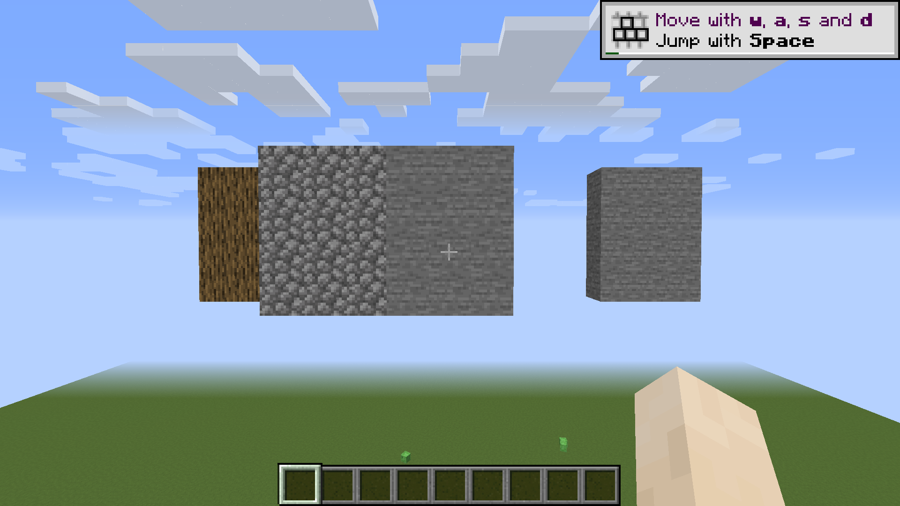
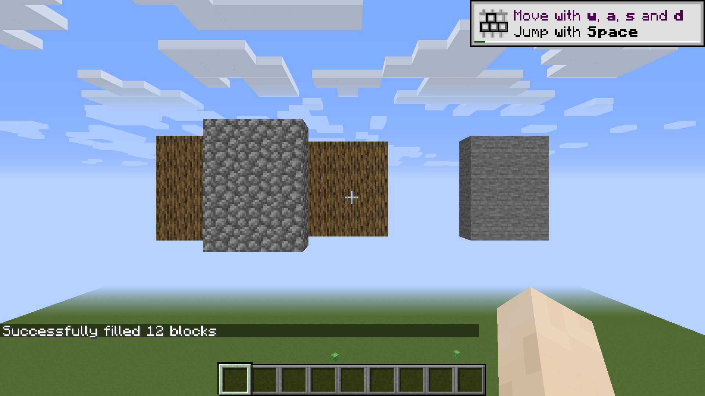
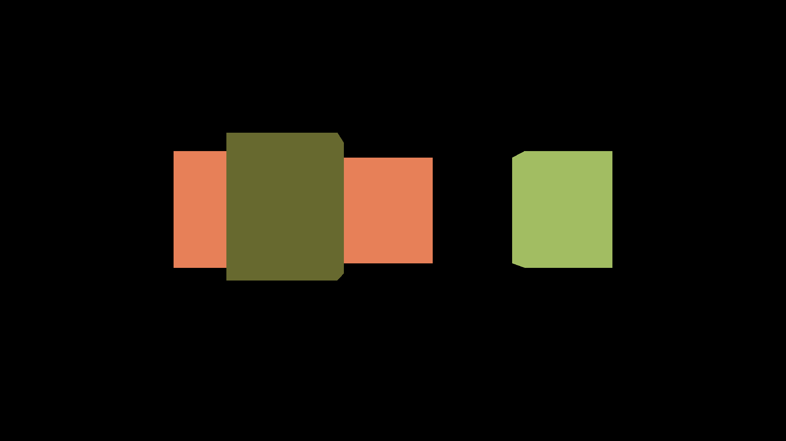

# Solid-block semantic classes

**Verified outcome:** Minecraft Java Edition 1.16.1 rendered three representative solid-layer block identities into camera-aligned semantic images using their exact 763-entry manifest class IDs. Cobblestone decoded as `139`, oak log as `444`, and stone as `662`; the two values above 255 were preserved without truncation.

| | |
| --- | --- |
| Status | Experimental successor milestone, verified within the scope described below |
| Target | Minecraft Java Edition 1.16.1 |
| Tested implementation | `a7e6a193e0aa27829cd8ef5fa8f64e43ed154622` (`feat(semantic): render solid manifest classes`) |
| Manual verification | September 6, 2026 |
| Manifest | 763 entries; SHA-256 `37af04fd5db5f797773782b3b8396e0247c171bf8ad13e56e1408e22335f937b` |

## Question

Can the renderer-derived approach from the [earlier two-class proof of concept](semantic-observation-poc.md) use the complete Minecraft 1.16.1 block-identity vocabulary and preserve class IDs larger than one byte, without repurposing normal RGB vertex data or exposing hidden world state?

The tested result answers that question affirmatively for representative ordinary block models in Minecraft's solid chunk render layer. This is a successor experiment, not a claim that the complete semantic observation interface is finished.

## What changed

The earlier proof of concept recognized only `minecraft:stone` and `minecraft:oak_log`. It stored a provisional class marker in one byte of Minecraft's normal vertex data, which could not represent the complete vocabulary.

The successor implementation builds an immutable vocabulary from the finalized Minecraft 1.16.1 block registry. Canonical registry identifiers are sorted lexicographically and assigned contiguous positive IDs; class `0` remains background. The verified vocabulary contains 763 entries:

| Semantic class | Registry identifier | Diagnostic color |
| ---: | --- | --- |
| 139 | `minecraft:cobblestone` | `#67692F` |
| 444 | `minecraft:oak_log` | `#E78058` |
| 662 | `minecraft:stone` | `#A2BD62` |

The 763 entries form a complete identity vocabulary, not a list of blocks known to produce solid geometry. Minecraft still decides whether a block state emits geometry and which render layer receives it. This milestone assigns positive classes only to ordinary block-model contributions routed through the solid layer.

## How the semantic sidecar works

During normal chunk construction, the mod resolves each solid-layer block's canonical registry identifier through the active manifest. For every vertex Minecraft emits, it stores a second, small record beside the normal vertex: the low and high bytes of the semantic class ID plus two guard bytes. This parallel record is the semantic sidecar. It is separate from the positions, textures, colors, lighting, and other data used for Minecraft's normal RGB image, so the normal vertex data is not recolored.

When F8 requests a capture, the mod replays Minecraft's already selected solid chunk buffers into an off-screen target. The replay uses the normal vertex positions but reads class bytes from the sidecar. Texturing, lighting, fog, blending, dithering, and other operations that could change those bytes are disabled for this pass. Every vertex of a quad must have the same class, and guard bytes are checked during readback. A manifest fingerprint mismatch, an unknown positive class, malformed quad data, or a sidecar length mismatch stops the capture instead of producing misleading output.

The replay retains Minecraft's geometry and its current camera projection, render-distance and frustum-selected chunk buffers, face culling, and solid-block depth behavior. The capture does not scan loaded blocks, read block coordinates during extraction, ray-cast across the world, or infer identities with a vision model.

Each capture produces three ignored runtime artifacts:

| Artifact | Contract |
| --- | --- |
| Class buffer | Unsigned 16-bit class IDs, little-endian, two bytes per pixel, row-major with a top-left origin; exact length `width × height × 2` |
| Metadata | Format version 2, dimensions and layout, runtime versions, manifest count and fingerprint, filenames, byte length, and only the classes observed in that frame |
| Visualization | Deterministic false-color PNG with class `0` shown as black |

The PNG is only a human inspection aid. Its colors are derived deterministically from numeric IDs and carry no meaning about usefulness, importance, or strategy.

## Test configuration and procedure

The project pins Minecraft `1.16.1`, Yarn `1.16.1+build.21`, Fabric Loader `0.9.3+build.207`, Fabric Loom `1.11.8`, and the Gradle `8.14.3` wrapper. The mod targets Java 8 bytecode, and the verified development client ran under Java 8 with Minecraft's default renderer and no shader or renderer-replacement mod.

The experiment reused the Creative superflat scene and construction commands from the [earlier test procedure](semantic-observation-poc.md#test-configuration). Three rear oak panels were paired with foreground stone and cobblestone occluders, plus separate visible reference panels. The verification sequence was:

1. Launch the pinned client with `.\gradlew.bat runClient`, construct the scene, and face it from the recorded test origin.
2. Press F2 for a normal screenshot and F8 for the baseline semantic capture.
3. Remove the foreground stone panel with `/fill -1 65 8 1 68 8 air`, then capture both views again.
4. Rotate the camera 180 degrees with `/tp @s 0.5 65 0.5 180 0`, then capture the behind-camera result.

All evaluated captures were `1920 × 1080` pixels.

## Results

| Test | Result |
| --- | --- |
| Class below 256 | Cobblestone decoded as `139` |
| Classes above 255 | Oak log decoded as `444`; stone decoded as `662` |
| Byte truncation | Neither `444` nor `662` was truncated |
| Solid occlusion | Nearer stone and cobblestone hid farther oak |
| Occluder removal | Removing stone revealed the expected oak surface |
| Behind-camera boundary | The final capture contained only class `0` |
| Buffer length | Every `1920 × 1080` buffer contained exactly `4,147,200` bytes |
| Visualization verification | Every false-color PNG matched its decoded class buffer pixel for pixel |
| Manifest identity | All captures reported 763 entries and the expected fingerprint |
| Runtime stability | No relevant capture, chunk-rendering, or Mixin failure appeared in the runtime log |

Decoded pixel counts provide a reproducible numeric summary:

| Class | Capture 1: baseline | Capture 2: stone removed | Capture 3: behind camera |
| ---: | ---: | ---: | ---: |
| 0 | 1,769,379 | 1,807,291 | 2,073,600 |
| 139 (`minecraft:cobblestone`) | 98,690 | 103,562 | 0 |
| 444 (`minecraft:oak_log`) | 36,950 | 93,097 | 0 |
| 662 (`minecraft:stone`) | 168,581 | 69,650 | 0 |

Capture 2's larger oak count and smaller stone count agree with the scene change: removing the foreground stone exposed the rear oak surface. Cobblestone remained visible and continued to hide the separate oak surface behind it. In Capture 3, all `2,073,600` pixels decoded as background.

The automated suite contained 21 focused JUnit tests covering manifest construction and validation, canonical identity mapping, separation from diagnostic raw IDs, fingerprint propagation and mismatch failure, unsigned 16-bit boundaries and byte order, exact output length, background handling, deterministic colors, semantic sidecar guards, constant-class quads, and nested tessellation state. `test`, `build`, and production remapping completed successfully.

Those automated checks establish the data contracts and defensive validation. Starting the actual pinned client established registry initialization, the 763-entry fingerprint, and Mixin application. The in-world captures establish the tested silhouettes, exact decoded GPU values, solid occlusion, removal behavior, and behind-camera result.

## Visual evidence

In the baseline pair, the same visible oak, cobblestone, and stone silhouettes appear in the normal and semantic views. The foreground cobblestone and stone panels hide their rear oak panels, while the separate reference surfaces remain visible.

| Normal Minecraft view | Semantic view |
| --- | --- |
|  |  |

After the stone occluder was removed, the normal image exposes the rear oak face at the vacated position. The semantic image shows the same revealed silhouette as oak class `444`, while cobblestone class `139` continues to hide the other rear oak panel.

| Normal Minecraft view | Semantic view |
| --- | --- |
|  |  |

After the camera turned away from the constructed scene, the semantic output was entirely black. The raw buffer independently confirmed that every pixel was class `0`.

## What this establishes

Within the tested default-renderer configuration, the runtime block manifest can supply exact, stable identifiers to real solid-layer render contributions. A separate semantic vertex stream can transport IDs above 255 through the GPU path without changing normal RGB vertices, and the resulting unsigned 16-bit image retains the renderer's visible geometry and depth occlusion.

Three representative identities exercised the shared generic mechanism; the experiment did not render or manually test all 763 registered blocks. The saved screenshots and captures also cannot determine whether pressing F8 caused a momentary visible flash on screen.

## Limitations

This milestone does not implement cutout or cutout-mipped layers, translucent blocks or classified fluids, entities, separately rendered block entities, particles, HUD or menu observations, F3, subtitles, lighting-based visibility thresholds, an object table, or continuous real-time observation streaming.

Capture still performs synchronous GPU readback and file output. Performance has not been profiled. Compatibility with shaders, renderer-replacement mods, and other non-default rendering pipelines is unsupported and untested. The experiment does not establish an agent-facing observation cadence, RGB stream, instance identity, or a complete semantic observation interface.

## Implementation map

| Responsibility | Relevant files |
| --- | --- |
| Pinned Minecraft, mappings, loader, build, and bytecode versions | [`build.gradle`](../../build.gradle), [`gradle.properties`](../../gradle.properties), [Gradle wrapper properties](../../gradle/wrapper/gradle-wrapper.properties) |
| Runtime registry manifest and immutable canonical vocabulary | [`BlockClassManifestProbe.java`](../../src/main/java/io/github/minecraftaidiscovery/semantic/manifest/BlockClassManifestProbe.java), [`BlockClassManifestRuntime.java`](../../src/main/java/io/github/minecraftaidiscovery/semantic/manifest/BlockClassManifestRuntime.java), [`BlockClassVocabulary.java`](../../src/main/java/io/github/minecraftaidiscovery/semantic/manifest/BlockClassVocabulary.java) |
| Canonical block-to-class mapping during solid chunk tessellation | [`ChunkRebuildTaskMixin.java`](../../src/main/java/io/github/minecraftaidiscovery/semantic/mixin/ChunkRebuildTaskMixin.java), [`SemanticVertexEncoding.java`](../../src/main/java/io/github/minecraftaidiscovery/semantic/SemanticVertexEncoding.java) |
| Parallel semantic vertex storage | [`BufferBuilderMixin.java`](../../src/main/java/io/github/minecraftaidiscovery/semantic/mixin/BufferBuilderMixin.java), [`SemanticVertexData.java`](../../src/main/java/io/github/minecraftaidiscovery/semantic/SemanticVertexData.java) |
| Sidecar upload and exact GPU replay | [`VertexBufferMixin.java`](../../src/main/java/io/github/minecraftaidiscovery/semantic/mixin/VertexBufferMixin.java), [`SemanticGpuTransport.java`](../../src/main/java/io/github/minecraftaidiscovery/semantic/SemanticGpuTransport.java), [`SemanticRenderPass.java`](../../src/main/java/io/github/minecraftaidiscovery/semantic/SemanticRenderPass.java) |
| Capture timing, unsigned 16-bit output, metadata, and visualization | [`WorldRendererMixin.java`](../../src/main/java/io/github/minecraftaidiscovery/semantic/mixin/WorldRendererMixin.java), [`SemanticCapture.java`](../../src/main/java/io/github/minecraftaidiscovery/semantic/SemanticCapture.java), [`SemanticClassEncoding.java`](../../src/main/java/io/github/minecraftaidiscovery/semantic/SemanticClassEncoding.java), [`SemanticCaptureMetadata.java`](../../src/main/java/io/github/minecraftaidiscovery/semantic/SemanticCaptureMetadata.java) |
| F8 capture trigger | [`KeyboardMixin.java`](../../src/main/java/io/github/minecraftaidiscovery/semantic/mixin/KeyboardMixin.java), [`SemanticCaptureRequests.java`](../../src/main/java/io/github/minecraftaidiscovery/semantic/SemanticCaptureRequests.java) |
| Focused automated tests | [`BlockClassManifestTest.java`](../../src/test/java/io/github/minecraftaidiscovery/semantic/manifest/BlockClassManifestTest.java), [`BlockClassVocabularyTest.java`](../../src/test/java/io/github/minecraftaidiscovery/semantic/manifest/BlockClassVocabularyTest.java), [`SemanticClassEncodingTest.java`](../../src/test/java/io/github/minecraftaidiscovery/semantic/SemanticClassEncodingTest.java), [`SemanticCaptureMetadataTest.java`](../../src/test/java/io/github/minecraftaidiscovery/semantic/SemanticCaptureMetadataTest.java), [`SemanticVertexDataTest.java`](../../src/test/java/io/github/minecraftaidiscovery/semantic/SemanticVertexDataTest.java) |
