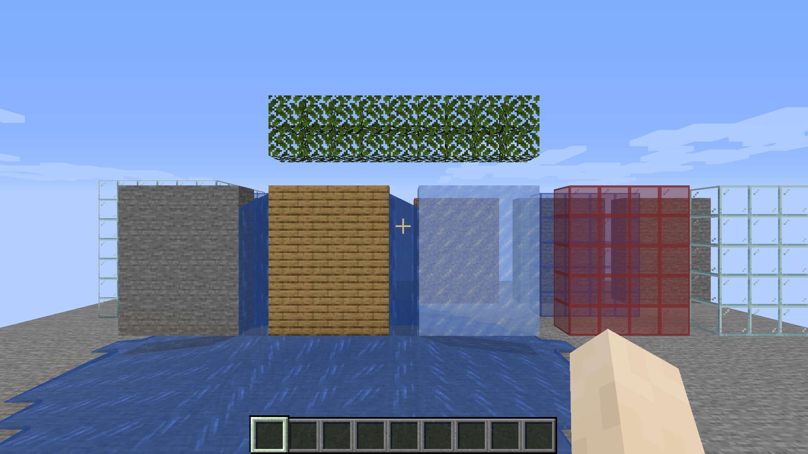
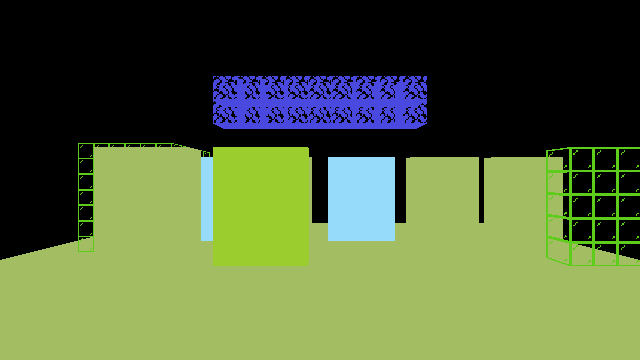
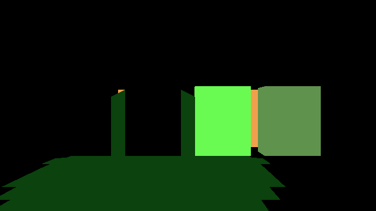
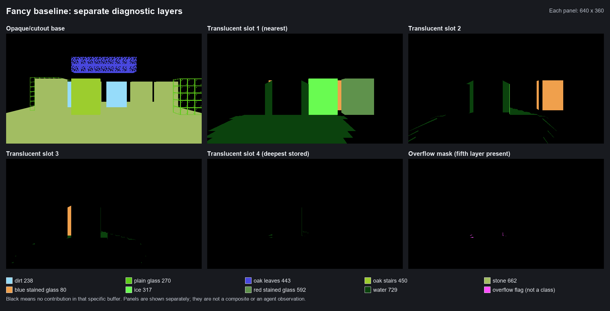
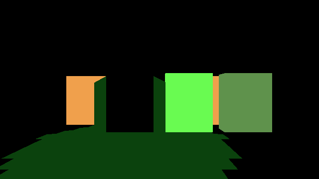
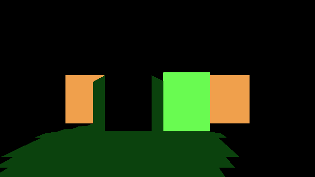
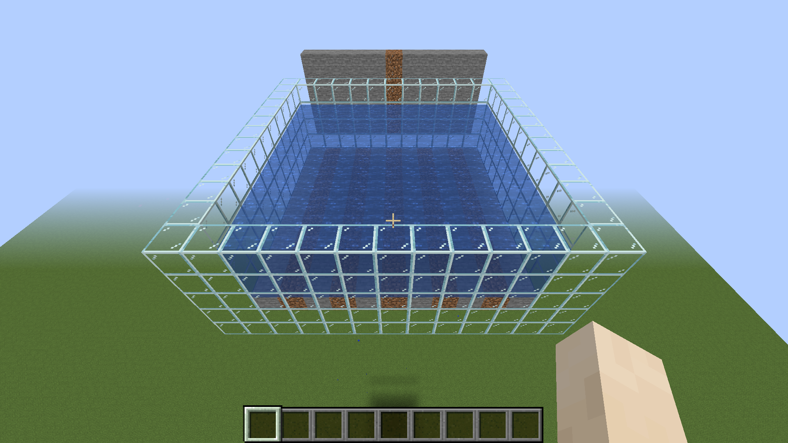
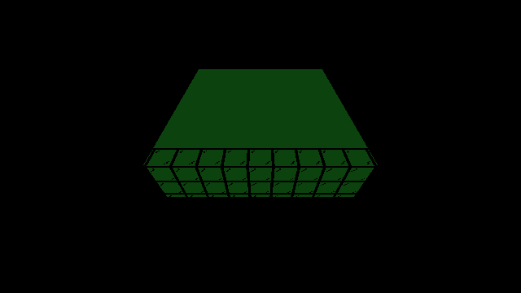
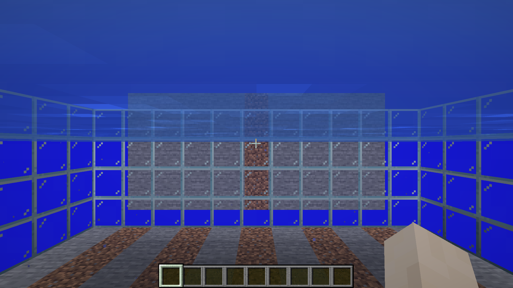

# Translucent observation diagnostic probe

**Verified outcome:** An opt-in Minecraft Java Edition 1.16.1 diagnostic captured renderer-derived translucent block-model and fluid contributions while preserving the opaque/cutout semantic result separately. A version-2 extension also measured the GPU-applied fog retention of the base contribution. The probe retained exact manifest identities through translucent sorting, detected candidate overflow, and left ordinary F8 captures unchanged.

| | |
| --- | --- |
| Status | Experimental researcher diagnostic, verified within the scope below |
| Target | Minecraft Java Edition 1.16.1 |
| Tested implementation | `2189e63afafd230c5efdc4710d2c729c41c3c1d8` (`feat(translucent): add base fog-retention probe`) |
| Manual verification | September 7 and September 12, 2026 |
| Probe format | `translucent-observation-probe-v2`, fixed `640 × 360` |
| Manifest | 763 entries; SHA-256 `37af04fd5db5f797773782b3b8396e0247c171bf8ad13e56e1408e22335f937b` |

## Purpose and scope

The [previous milestone](cutout-block-semantic-classes.md) established one class per pixel for solid and cutout geometry. Cutout textures still produce binary ownership: after the alpha test, a fragment either survives or leaves the geometry behind it visible. Blended translucency is different. Water, stained glass, ice, and the opaque scene behind them can all contribute to the same displayed pixel, so collapsing the result to one class loses visible structure.

This experiment tested whether Minecraft's actual renderer could provide enough evidence to study that problem without scanning world state. It also tested whether the renderer's fog effect on the opaque/cutout base could be isolated without treating camera medium or window depth as a proxy. It produced a manual, researcher-only diagnostic—not an agent observation. It does not approve a transparency policy or expose exact depth, alpha, fragment count, order, opacity, or fog retention to a learning agent.

The probe is disabled by default. Launching the development client with `-PtranslucentProbe=true` enables a dedicated F9 capture. F8 continues to produce the verified `semantic-observation-v3` `.classes.u16le` output.

## Diagnostic design

During chunk tessellation, a separate four-byte sidecar associates each emitted vertex with a manifest class ID and a source kind: block model or fluid renderer. It does not change Minecraft's ordinary RGB vertices. The sidecar follows Minecraft's complete-quad permutation during the initial translucent sort and later camera-driven resorts.

Fluid identity is attached around the renderer's own fluid call. Water geometry uses `minecraft:water` (`729`) and lava geometry uses `minecraft:lava` (`354`). A waterlogged stair therefore retains `minecraft:oak_stairs` (`450`) for its independently rendered block model and water `729` for its fluid contribution; the identities are not collapsed.

F9 replays the renderer-selected terrain into diagnostic framebuffers:

1. Solid, cutout-mipped, and cutout layers form an independent base class image and depth limit. Plain glass remains in this base in Minecraft 1.16.1.
2. Four depth peels store translucent contributions from front to back. A fifth peel sets an overflow flag instead of silently implying that four entries were complete.
3. The same stored samples are also ranked by an effective source-over alpha coefficient. This ranking is derived by the interface; it is not Minecraft's geometric order or a perceptual-visibility score.
4. Separate passes record researcher-only window depth, sampled atlas alpha, accumulated opacity, and accepted-fragment count.
5. A separate base replay draws white solid/cutout terrain against black fog using Minecraft's active fixed-function fog state. Its normalized RGB value directly records base fog retention: `0` is fully fogged and `255` is fully retained. Background-class geometry still participates in depth occlusion but is stored as zero rather than becoming a base contribution.

The fog replay records and validates its active mode, density or linear range, distance mode, camera medium, underwater visibility, swamp modifier, view distance, perspective, projection, thick-fog state, and relevant status effects. It fails instead of producing a fog channel for unsupported graphics modes, non-vanilla resource packs, active post shaders, unknown fog state, or inconsistent Minecraft 1.16.1 parameters. This validation applies to the fog extension; the earlier v1 candidate captures retain their original tested scope.

`base.fog-retention.u8` stores one normalized unsigned byte per row-major pixel. The version-2 metadata describes the artifact and preserves the captured fog state needed to interpret it. This channel remains researcher-only and is zero wherever the separate base class buffer contains background.

The capture-local PNGs are inspection aids. `base.png` visualizes the opaque/cutout base, `base-fog-retention.png` visualizes the new grayscale retention channel, and `translucent-frontmost.png` visualizes only the first translucent slot. The last of these does **not** show all stored layers.

## Verification

The original version-1 controlled Creative scene used bundled resources and `1920 × 1080` RGB screenshots. Probe output remained fixed at `640 × 360`. It included stone and dirt, plain and stained glass, ice, waterlogged stairs, water, lava, overlapping translucent surfaces, an opaque occluder, and an off-camera boundary. Those captures covered Fancy, Fast, and Fabulous graphics, a camera-driven translucent resort, above-water and underwater views, and a skyward view.

All 60 automated tests passed, followed by the build and production remapping. The tests cover opt-in configuration, canonical fluid identity, source separation, uint16 preservation, sidecar sorting and saved state, serialization, candidate ordering and ranking, explicit overflow, fog formulas and metadata boundaries, and the unchanged ordinary v3 contract. Automated checks do not establish in-world visual behavior; that came from the original nine F9 capture sets plus four later fog controls, paired RGB images, independent raw-buffer decoding, and log inspection.

The principal results were:

| Check | Verified result |
| --- | --- |
| Opaque occlusion | The wall suppressed hidden translucent geometry; removing it exposed 6,664 additional blue-stained-glass samples and 2,864 lava samples |
| Overlapping glass | Removing red stained glass eliminated 12,668 red samples and promoted blue stained glass in exactly 6,664 frontmost pixels |
| Sorting | After a camera movement greater than one block, identities remained attached to the correct geometry and all populated slots remained front-to-back |
| Fluids | Water `729` appeared only as a translucent fluid contribution; solid-routed lava `354` appeared in its separate fluid diagnostic |
| Waterlogging | Oak stairs remained class `450` in the base while water `729` overlapped 110 corresponding pixels in captures 1–3 |
| Graphics modes | The translucent candidate, ranking, opacity, count, and overflow buffers were byte-identical across the controlled Fancy, Fast, and Fabulous captures |
| Camera medium | Above water recorded medium `none` and 31,917 water samples; underwater recorded `minecraft:water` and 113,208 water samples |
| Camera boundary | The skyward capture contained no test-scene contribution in any base, fluid, candidate, opacity, count, or overflow buffer |

Four slots covered most pixels in these scenes, but did not represent every contribution in every tested pixel. The overflow mask reported 36 pixels in Capture 1, 51 pixels in Captures 2–3, 43 pixels in Captures 4–6, and none in the two water scenes. No accepted-fragment counter saturated. Front-to-back and contribution-ranked order differed on 10 pixels in Captures 1–3 and 37 pixels in Captures 4–6, confirming that the choice can change retained order.

Every declared buffer had the correct length, all class IDs and metadata counts decoded correctly, and every diagnostic visualization matched its source buffer pixel for pixel. No F9 flash, RGB corruption, crash, prolonged stall, or probe-specific rendering, Mixin, serialization, or buffer failure was observed.

### Base fog-retention controls

The version-2 controls ran with Fancy graphics, bundled resources, no post shader, first-person perspective, and an OpenGL implementation without `NV_fog_distance`. The recorded distance mode was therefore standard absolute eye-plane distance. Expected values were reconstructed from each saved projection matrix and base depth using the recorded Minecraft fog parameters, then compared with the direct GPU readback for every labeled base pixel.

| Control | Recorded fog state | Labeled base pixels | Retention values | Maximum byte error |
| --- | --- | ---: | ---: | ---: |
| Ordinary terrain distance | Linear, start `84`, end `112` | 128,938 | `0–255` | `0` |
| Stabilized underwater tunnel | EXP2, density `0.020000001`, underwater visibility `1.0` | 230,400 | `8–255` | `1` |
| Lava near wall | Linear, start `0.25`, end `1.0`, no Fire Resistance | 230,400 | constant `68` | `0` |
| Blindness tunnel | Linear, start `1.25`, end `5.0` | 230,400 | `102–220` | `1` |

The ordinary and lava controls matched exactly. In the water control, 2,446 pixels differed by one byte and the mean absolute error was `0.010616`; in the Blindness control, 5,330 differed by one byte and the mean was `0.023134`. No pixel in either control differed by more than one byte. These small differences are consistent with normalized framebuffer quantization and reconstructing distance from stored depth; the saved channel itself comes from Minecraft's active GPU fog calculation.

This establishes that fog retention is separately measurable on the tested linear and EXP2 paths. It does not establish a perceptual visibility threshold or show that fog is the only condition affecting whether a base identity should be exposed.

## Visual evidence

The visualizations use deterministic false colors to identify classes; they intentionally do not resemble the blocks' normal RGB appearance.

| Identity | Class | False color |
| --- | ---: | --- |
| Blue stained glass | `80` | `#F0A04C` |
| Ice | `317` | `#69FB51` |
| Red stained glass | `592` | `#5F924C` |
| Water | `729` | `#0B420D` |
| Dirt | `238` | `#96DCFA` |
| Plain glass | `270` | `#5DCC1A` |
| Oak leaves | `443` | `#4948DF` |
| Oak stairs | `450` | `#9CCD2E` |
| Stone | `662` | `#A2BD62` |

The baseline shows the normal scene, its separate opaque/cutout base, and only the nearest translucent candidate. Black areas in either diagnostic view mean that particular representation has no positive class there, not that the full diagnostic contains no deeper contribution.

| Normal Minecraft view | Opaque/cutout base | Frontmost translucent slot only |
| --- | --- | --- |
|  |  |  |

*Baseline layer breakdown generated directly from the verified class and candidate buffers. Each panel is independent: black means that buffer or slot has no contribution at that pixel. The magenta overflow mask marks 36 pixels where a fifth translucent layer existed; it is not a semantic class. The panels are not composited and do not define a final agent observation.*

Removing the opaque wall reveals blue stained glass in the left test panel. Removing the nearer red glass then promotes the farther blue sheet in the right panel. These images show only the frontmost slot; the numerical result above comes from all stored slots and the separate fluid record.

| Wall removed | Nearest red glass removed |
| --- | --- |
|  |  |

| Above-water RGB view | Frontmost rendered water contribution |
| --- | --- |
|  |  |

| Underwater RGB view | Frontmost rendered water contribution |
| --- | --- |
|  |  |

The underwater pair also illustrates an unresolved boundary: the base diagnostic remains available even when fog and the camera overlay affect the ordinary view. Whether an agent may receive that base is not decided here.

## Performance and Fabulous-mode note

One version-2 F9 capture synchronously performs fourteen terrain-layer replays, seventeen GPU readbacks, and writes approximately 18.9 MB of raw data plus three PNGs and metadata on the render thread. The observed sub-second hitch was expected for this one-shot diagnostic. Its exact duration was not profiled, and this result does not establish acceptable performance for continuous observation.

The tested AMD Radeon RX 7600 environment emitted high-severity OpenGL messages while vanilla Fabulous graphics was active. Earlier version-1 controls proved that Minecraft 1.16.1's Fabulous compositor—not semantic rendering—issues eight invalid legacy fixed-function texture enable/disable calls per composition for sampler units 8–11. Those captures retained that exact cadence and showed no probe corruption. The version-2 fog channel deliberately supports only Fast and Fancy graphics and fails closed in Fabulous mode. No vanilla compatibility patch was added; cross-vendor, driver, and cloud-renderer testing remains future work.

## What remains unresolved

The probe establishes that multiple renderer-derived identities, fluid sources, and the supported base fog factor can be measured, not what an agent should receive. Base suppression, the final candidate count, overflow semantics, alpha or contribution thresholds, front-to-back versus ranked retention, any fog threshold, and agent-visible fields remain undecided. Exact depth, sampled alpha, opacity, count, ordering, and fog retention remain researcher-only.

The experiment also excludes entities, block entities, particles, tripwire, weather, clouds, lighting response, first-person overlays, HUD and menus, custom resource packs, shader packs, replacement renderers, performance optimization, and continuous streaming. Fog verification covers only the tested standard eye-plane distance implementation; the NV radial path and other GPUs remain untested. Candidate slots are rendered fragment layers, not object instances.

## Implementation map

| Responsibility | Relevant files |
| --- | --- |
| Opt-in configuration and F9 request | [`TranslucentProbeConfiguration.java`](../../src/main/java/io/github/minecraftaidiscovery/semantic/translucent/TranslucentProbeConfiguration.java), [`TranslucentProbeCaptureRequests.java`](../../src/main/java/io/github/minecraftaidiscovery/semantic/translucent/TranslucentProbeCaptureRequests.java), [`KeyboardMixin.java`](../../src/main/java/io/github/minecraftaidiscovery/semantic/mixin/KeyboardMixin.java) |
| Block-model and fluid identities | [`ChunkRebuildTaskMixin.java`](../../src/main/java/io/github/minecraftaidiscovery/semantic/mixin/ChunkRebuildTaskMixin.java), [`TranslucentProbeFluidIdentity.java`](../../src/main/java/io/github/minecraftaidiscovery/semantic/translucent/TranslucentProbeFluidIdentity.java), [`TranslucentProbeSource.java`](../../src/main/java/io/github/minecraftaidiscovery/semantic/translucent/TranslucentProbeSource.java) |
| Sidecar storage, sorting, and saved state | [`TranslucentProbeVertexData.java`](../../src/main/java/io/github/minecraftaidiscovery/semantic/translucent/TranslucentProbeVertexData.java), [`BufferBuilderMixin.java`](../../src/main/java/io/github/minecraftaidiscovery/semantic/mixin/BufferBuilderMixin.java), [`BufferBuilderStateMixin.java`](../../src/main/java/io/github/minecraftaidiscovery/semantic/mixin/BufferBuilderStateMixin.java) |
| GPU upload, atlas-alpha sampling, and state restoration | [`VertexBufferMixin.java`](../../src/main/java/io/github/minecraftaidiscovery/semantic/mixin/VertexBufferMixin.java), [`TranslucentProbeGpuTransport.java`](../../src/main/java/io/github/minecraftaidiscovery/semantic/translucent/TranslucentProbeGpuTransport.java), [`TranslucentProbeRenderPass.java`](../../src/main/java/io/github/minecraftaidiscovery/semantic/translucent/TranslucentProbeRenderPass.java) |
| Fog-state validation and fixed-function retention replay | [`FogRetentionCaptureContext.java`](../../src/main/java/io/github/minecraftaidiscovery/semantic/translucent/FogRetentionCaptureContext.java), [`FogRetentionParameters.java`](../../src/main/java/io/github/minecraftaidiscovery/semantic/translucent/FogRetentionParameters.java), [`FogRetentionGpuTransport.java`](../../src/main/java/io/github/minecraftaidiscovery/semantic/translucent/FogRetentionGpuTransport.java), [`FogRetentionRenderPass.java`](../../src/main/java/io/github/minecraftaidiscovery/semantic/translucent/FogRetentionRenderPass.java) |
| Diagnostic passes, buffers, ranking, metadata, and renderer integration | [`TranslucentProbeCapture.java`](../../src/main/java/io/github/minecraftaidiscovery/semantic/translucent/TranslucentProbeCapture.java), [`TranslucentProbeCandidates.java`](../../src/main/java/io/github/minecraftaidiscovery/semantic/translucent/TranslucentProbeCandidates.java), [`TranslucentProbeMetadata.java`](../../src/main/java/io/github/minecraftaidiscovery/semantic/translucent/TranslucentProbeMetadata.java), [`WorldRendererMixin.java`](../../src/main/java/io/github/minecraftaidiscovery/semantic/mixin/WorldRendererMixin.java) |
| Focused automated tests | [`TranslucentProbeVertexDataTest.java`](../../src/test/java/io/github/minecraftaidiscovery/semantic/translucent/TranslucentProbeVertexDataTest.java), [`TranslucentProbeCandidatesTest.java`](../../src/test/java/io/github/minecraftaidiscovery/semantic/translucent/TranslucentProbeCandidatesTest.java), [`TranslucentProbeFluidIdentityTest.java`](../../src/test/java/io/github/minecraftaidiscovery/semantic/translucent/TranslucentProbeFluidIdentityTest.java), [`TranslucentProbeMetadataTest.java`](../../src/test/java/io/github/minecraftaidiscovery/semantic/translucent/TranslucentProbeMetadataTest.java), [`TranslucentProbeGpuTransportTest.java`](../../src/test/java/io/github/minecraftaidiscovery/semantic/translucent/TranslucentProbeGpuTransportTest.java), [`FogRetentionParametersTest.java`](../../src/test/java/io/github/minecraftaidiscovery/semantic/translucent/FogRetentionParametersTest.java) |
